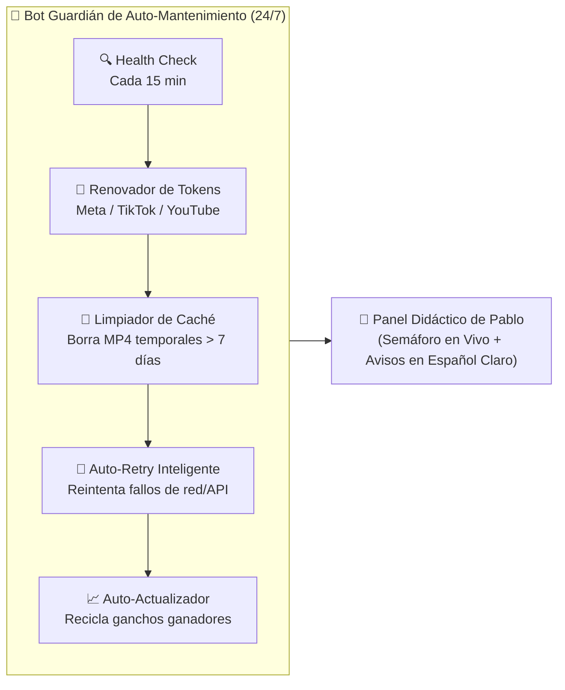

# Especificación Técnica: Bot Guardián de Auto-Mantenimiento & Panel Didáctico Personal
> **Módulo:** `05_BOT_GUARDIAN_AUTOMANTENIMIENTO_Y_PANEL_DIDACTICO.md`  
> **Enfoque:** Exclusivo para uso personal de Pablo — Cero fricción técnica, 100% auto-sustentable, didáctico y con mantenimiento autónomo.

---

## 1. Filosofía del Sistema: "Piloto Automático con Bot Mecánico Propio"

El mayor problema de las herramientas de automatización (como Make, Zapier o scripts caseros) es que **se rompen solas**: caduca un token de Instagram, cambia una URL de TikTok, se llena el disco duro de videos temporales o falla una llamada a ElevenLabs, y el dueño tiene que meterse a arreglar cables técnicos.

Para que esta herramienta sea **100% auto-sustentable, rápida y eterna para Pablo**, el sistema incorpora dos pilares nuevos que **Cursor / Grok / Claude** deben programar desde la base:

1. **Interfaz Modo Didáctico ("1-Clic + Explicación Humana"):** Ningún mensaje de error en código ni pantallas saturadas. Todo se opera con semáforos visuales (🟢 Todo listo / 🟡 Atención / 🔴 El Bot lo está arreglando) y tarjetas paso a paso.
2. **El Bot Guardián de Auto-Mantenimiento (`AutoHealBot`):** Un agente en segundo plano (cron job + worker autónomo) que vigila, repara, limpia y actualiza la aplicación sin que Pablo tenga que tocar código jamás.

---

## 2. Arquitectura del Bot Guardián de Auto-Mantenimiento (`AutoHealBot`)



### Las 5 Funciones Automáticas del Bot Guardián:

| # | Sub-Módulo del Bot | ¿Qué problema resuelve solo? | ¿Cómo actúa sin molestar a Pablo? |
|---|---|---|---|
| **1** | **Renovador Automático de Sesiones (`TokenRefresher`)** | Los permisos de Instagram/Facebook/TikTok suelen caducar cada 60 días y detienen las publicaciones. | Cinco días antes de que venza cualquier permiso, el Bot lo renueva automáticamente vía `refresh_token`. Si requiere clic humano, muestra un único botón gigante en pantalla: *"Conectar cuenta con 1 clic"*. |
| **2** | **Curador de Enlaces y Videos Caídos (`AssetHealer`)** | En el CSV de TikTok o bancos de videos, a veces un link de TikTok o audio se cae (`404 Not Found`). | Antes de renderizar, el Bot verifica que el video y la música existan. Si uno está caído, **no detiene la fila**: salta automáticamente al siguiente video sano del banco y marca el roto en cuarentena. |
| **3** | **Conserje de Almacenamiento (`StorageJanitor`)** | Generar 100 videos al mes en HD llena rápido cualquier servidor o computadora. | Una vez que un video ya se publicó con éxito en las 4 redes sociales, el Bot espera 7 días y borra los archivos temporales pesados (`.mp4` y `.wav` intermedios), conservando solo el registro ligero y el enlace publicado. |
| **4** | **Escudo Anti-Fallos de IA (`FallbackEngine`)** | Si un día ElevenLabs o el modelo de IA principal está lento o en mantenimiento. | El Bot reintenta 3 veces con pausa exponencial (`2s`, `10s`, `30s`). Si el servicio externo sigue caído, cambia automáticamente al motor de respaldo (ej. OpenAI TTS / Edge TTS) para que el calendario del día nunca se quede vacío. |
| **5** | **Auto-Actualizador de Ganchos (`SelfUpdater`)** | Los ganchos virales se gastan con los meses. | Cada semana, el Bot revisa qué patrón de gancho (`H1` a `H5` de Grok) tuvo más retención/vistas y genera nuevas variaciones frescas en segundo plano para la siguiente semana, manteniendo el sistema siempre al día. |

---

## 3. Diseño del Panel Didáctico para Pablo (Reglas de UI/UX para Cursor)

Para que la aplicación sea **más fácil y didáctica que `iamarketing.net`**, la interfaz debe cumplir estas 4 reglas estrictas:

1. **Cero Jerga Técnica:**
   - ❌ Prohibido mostrar en pantalla: `JSON`, `Webhook`, `Payload`, `Status 500`, `FFmpeg`, `Hook_ID`, `Cron`.
   - ✅ En su lugar usar: *"Guion listo"*, *"Voz grabada"*, *"Video armado"*, *"El Bot está trabajando"*.
2. **Modo "Semáforo de Salud" en la Esquina Superior:**
   - Un indicador siempre visible que diga: **🤖 Bot Guardián: Activo (Todo funcionando al 100%)**. Al hacer clic, el Bot te platica en español sencillo qué hizo hoy (*"Hoy limpié 12 archivos viejos, verifiqué tus 80 videos de mecánica y dejé listos los 2 videos de mañana"*).
3. **Flujo Guiado en 3 Pasos Grandes (Estilo Cajero Automático / Wizard):**
   - **Paso 1 — ¿De qué hablamos hoy?:** Eliges la tarjeta visual de tu nicho (ej. *Mecánica de Motos*, *Creadoras Faceless*, *Finanzas*, *Repostería*).
   - **Paso 2 — Escucha y Aprueba:** Ves las tarjetas con el texto que escribió la IA y un botón de ▶️ **Escuchar Voz** y 🎬 **Ver Video**. Si una palabra no te gusta, haces clic encima y la cambias como en Word.
   - **Paso 3 — Piloto Automático:** Un solo interruptor grande: **"Activar Publicación Automática (2 al día: Almuerzo y Noche)"**.
4. **Asistente Didáctico Integrado (Tooltips y Mini-Guías):**
   - Cada sección tiene un pequeño botón `💡 ¿Cómo funciona esto?` que explica en 2 renglones y con dibujos sencillos para qué sirve ese botón y por qué Grok recomienda hacerlo así.

---

## 4. Estructura de Archivos Propuesta para el Código (Para Cursor)

Cuando Cursor construya el módulo ejecutable, deberá seguir esta estructura limpia y modular:

```text
automatizaciones/
├── 01_PROMPTS_100_COPYS_NICHOS_AIDA.md         # Base de 100 copys AIDA en 12 nichos
├── 02_BASE_DATOS_TIKTOKS_MECANICA.csv          # 80 videos reales listos para procesar
├── 03_MAKE_BLUEPRINT_SCENARIO.json             # Lógica original de Make (referencia)
├── 04_GROK_ESTRATEGIA_VIRAL_2026.md            # Reglas de algoritmo 2026 y estructura de ganchos
├── 05_BOT_GUARDIAN_AUTOMANTENIMIENTO_Y_PANEL_DIDACTICO.md # Este documento (Especificación del Bot y UI)
├── HANDBOOK_SUPER_HERRAMIENTA_AUTOMATIZACION.md # Visión general y arquitectura en 4 capas
└── app-auto-studio/                            # (Directorio donde Cursor/Grok creará la App)
    ├── bot-guardian/
    │   ├── healthCheck.ts                      # Revisa APIs, links caídos y tokens cada 15 min
    │   ├── storageJanitor.ts                   # Limpia videos viejos automáticamente
    │   ├── autoRetryQueue.ts                   # Reintenta tareas sin intervención humana
    │   └── selfUpdater.ts                      # Actualiza ganchos y palabras seguras
    ├── engine/
    │   ├── scriptGenerator.ts                  # Generador AIDA + reglas de Grok (H1-H5)
    │   ├── voiceService.ts                     # ElevenLabs + Respaldo automático
    │   └── videoRenderer.ts                    # Unión de video + voz + subtítulos 9:16
    └── ui/
        ├── DashboardDidactico.tsx              # Pantalla principal 1-2-3 para Pablo
        └── WidgetBotGuardian.tsx               # Semáforo y bitácora hablada del Bot
```
