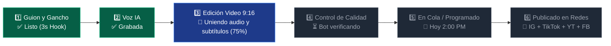

# Auditoría Funcional de `iamarketing.net` y Diseño del Clon Superior para Pablo
> **Documento:** `07_AUDITORIA_MODELO_IAMARKETING_10_CANALES_Y_TRACKER_VIVO.md`  
> **Objetivo:** Extraer lo mejor de la experiencia visual y operativa de `iamarketing.net` (10 canales simultáneos + barra de progreso en vivo paso a paso) y construirlo gratis y sin límites para uso exclusivo de Pablo.

---

## 1. Radiografía Técnica: ¿Qué hace realmente `iamarketing.net` por dentro?

Al cruzar lo que muestra `iamarketing.net` en su interfaz con el archivo `03_MAKE_BLUEPRINT_SCENARIO.json` que ya tenemos en nuestro poder, queda al descubierto su secreto técnico:

1. **Por qué cobran tan caro:** Ellos te venden una "pantalla bonita" que por debajo hace exactamente los mismos 5 pasos que están en tu JSON (`Leer guion` $\rightarrow$ `Generar voz en ElevenLabs` $\rightarrow$ `Unir video y música en un servidor Python/FFmpeg en el puerto 5001` $\rightarrow$ `Consultar el estado con /check_status/{task_id}` $\rightarrow$ `Subir a Instagram, YouTube, TikTok y Facebook`).
2. **Por qué su interfaz gusta tanto (El Efecto "Rastreador de Pizza / Uber Eats"):**
   - En lugar de enseñarte cables feos como Make.com, ellos usan el endpoint `/check_status/{task_id}` para encender **bolitas de progreso en tiempo real** que te van avisando qué está pasando en cada segundo:
     - `Paso 1: Redactando guion viral...` 🟢
     - `Paso 2: Grabando voz con IA...` 🟢
     - `Paso 3: Montando video y subtítulos...` 🔄 *(En proceso - 68%)*
     - `Paso 4: Programando en calendario...` ⚪
     - `Paso 5: Enviado y publicado en Redes Sociales` ⚪
3. **El Sistema de "Hasta 10 Automatizaciones / 10 Canales":**
   - Te permiten crear hasta **10 "Cajas" o "Canales" independientes** (por ejemplo: *Canal 1: Motos*, *Canal 2: Creadoras Faceless*, *Canal 3: Finanzas*, *Canal 4: Herramientas IA*, *Canal 5: Repostería*, etc.).
   - Cada Canal tiene **su propia voz asignada**, **su propio banco de videos**, **su propio horario** y **sus propias cuentas de TikTok/IG/YouTube/FB conectadas**, para que no se mezclen unos con otros.

---

## 2. Lo que Vamos a Copiar (y Mejorar) en Tu Herramienta Personal

### A. El "Rastreador en Vivo Paso por Paso" (Live Pipeline Tracker)
Cada vez que tu herramienta esté trabajando en un video, verás en tu pantalla una **Línea de Tiempo Animada en Vivo** con 6 estaciones claras y avisos en español sencillo:

- **Notificaciones en vivo tipo WhatsApp / Toast en pantalla:**
  - 💬 *"✍️ Creando guion con gancho de 3 segundos para Mecánica..."*
  - 💬 *"🎙️ Voz grabada con éxito (duración: 42 segundos)..."*
  - 💬 *"🎬 Armando el video vertical y pegando subtítulos amarillos..."*
  - 💬 *"📅 Video programado para hoy a las 8:00 PM (Horario estelar)..."*
  - 💬 *"🚀 ¡Listo! Enviado y publicado en Instagram, TikTok, YouTube y Facebook."*

---

### B. El Centro de 10 Canales Simultáneos ("Multi-Channel Hub")
En lugar de tener todo revuelto, la pantalla principal de Pablo tendrá **10 Tarjetas de Canales (Slots 1 al 10)** listas para encender o apagar con un interruptor (`ON / OFF`):

| Slot | Ejemplo de Canal / Nicho | Voz Asignada | Ritmo de Publicación | Estado en Vivo |
|---|---|---|---|---|
| **Canal 1** | 🏍️ **Mecánica de Motos** (80 videos listos) | Voz Masculina Taller | 2 al día (1:00 PM y 8:30 PM) | 🟢 **Activo** (Creando video #14...) |
| **Canal 2** | 🦊 **Creadoras Faceless / Monetiza** | Voz Femenina Scarlett | 2 al día (2:00 PM y 9:30 PM) | 🟢 **Activo** (Programado 2:00 PM) |
| **Canal 3** | 💵 **Finanzas y Dólares LATAM** | Voz Ejecutiva Clara | 2 al día (12:30 PM y 8:00 PM) | 🟢 **Activo** (Enviando a Reels...) |
| **Canal 4** | 🤖 **Herramientas de IA (IA Tools)** | Voz Tech Dinámica | 2 al día (1:30 PM y 9:00 PM) | 🟢 **Activo** (En cola para hoy) |
| **Canal 5** | 🧁 **Repostería / Postres Rentables** | Voz Femenina Cálida | 2 al día (11:30 AM y 7:30 PM) | ⚪ Pausado (Listo para activar) |
| **Canales 6–10** | ➕ **Espacios Libres (Resina, Cripto, Fitness, etc.)** | A elegir con 1 clic | Configurable | ⚪ Disponibles |

---

### C. En qué Supera Nuestra Herramienta a `iamarketing.net`

| Característica | `iamarketing.net` (Comercial) | **Tu Super-Herramienta Personal (VENUZ Auto-Studio)** |
|---|---|---|
| **Costo Mensual** | Membresía cara mensual/anual | **$0 de renta mensual** (es 100% tuya para siempre) |
| **Límite de Canales** | Topado a 10 canales por plan | **10 canales en pantalla (o los que quieras agregar después)** |
| **Calidad de Ganchos** | Copys genéricos de ChatGPT | **Fórmula Grok 2026** (Retención >75% a los 3s + Comentario-Cebo) |
| **Si falla una API o link** | Se traba el flujo y pierdes el día | **Bot Guardián 24/7 (`AutoHealBot`)** que brinca enlaces caídos y se repara solo |
| **Servidor de Video** | Dependes de su servidor externo lento | **Motor propio local/privado** sin marcas de agua ni filas de espera |

---

## 3. Instrucción Adicional para Claude y Cursor (Para Integrar Ya)

Tanto **Claude** (en su arquitectura de código) como **Cursor** (al armar las pantallas) deben incluir obligatoriamente estos 2 componentes visuales:
1. **`MultiChannelGrid.tsx` (Panel de los 10 Canales):** Vista de cuadrícula con las 10 tarjetas de automatización independientes, cada una con su botón de `Encender/Pausar`, selector de nicho, voz y cuentas conectadas.
2. **`LiveProcessTracker.tsx` (Visor Paso a Paso en Tiempo Real):** Barra visual mediante Server-Sent Events (SSE) o polling cada 2 segundos a `/api/check-status/[taskId]` que ilumine en vivo cada etapa: **Creando Guion $\rightarrow$ Grabando Voz $\rightarrow$ Renderizando Video $\rightarrow$ Programando $\rightarrow$ Enviando a Redes $\rightarrow$ ¡Publicado!**.
