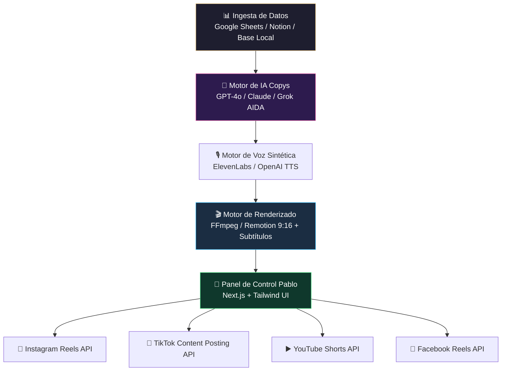

# Handbook Maestro: Super-Herramienta de Automatización de Video Marketing con IA
> **Proyecto:** Pablo Growth Engine / VENUZ Auto-Studio  
> **Referencia de Modelo:** `iamarketing.net` (Automatización omnicanal con IA sin fricción técnica)  
> **Versión:** 1.0 · Noviembre 2026  
> **Objetivo:** Crear una plataforma web personal, visual y ultra-intuitiva para generar guiones virales AIDA, montar videos con voz IA y publicarlos en automático en TikTok, Instagram Reels, YouTube Shorts y Facebook.

---

## 1. La Visión: Por qué sustituir Make.com por una App Propia

Make.com es una excelente herramienta para prototipar, pero para operar a diario tiene 3 problemas graves:
1. **Fricción visual:** El laberinto de módulos, cables y parámetros técnicos es confuso y poco amigable.
2. **Fragilidad de conexiones:** Si expira un token de Facebook o una API key, todo el flujo se detiene en silencio.
3. **Costo por operaciones:** Cada vez que el escenario monitorea una fila o ejecuta un paso de espera (*Sleep*), consume créditos de Make.

### La Solución: El Modelo `iamarketing.net`
Inspirados en la simplicidad de plataformas como **iamarketing.net**, creamos una **interfaz gráfica limpia en Next.js / Tailwind**, diseñada para que Pablo (o cualquier operador) pueda:
1. **Seleccionar un Nicho con 1 Clic** (Mecánica de Motos, Repostería, Creadoras 18+, Finanzas, Resina, etc.).
2. **Generar y Aprobar 10–50 Guiones AIDA con IA** en una tabla visual con previsualización de voz.
3. **Renderizar el Video Vertical (9:16)** automáticamente: video de fondo + música en tendencia + voz en off + subtítulos animados estilo TikTok.
4. **Programar y Publicar en Multiplataforma** (Instagram, TikTok, YouTube Shorts y Facebook) con un solo botón verde.

---

## 2. Arquitectura de la Aplicación en 4 Capas



### Capa 1: El Banco de Contenidos (Database & Storage)
- **Supabase / PostgreSQL:** Almacena la biblioteca de nichos, los ganchos virales (hooks), los guiones aprobados y el historial de videos publicados.
- **Bucket de Almacenamiento (Supabase Storage / Cloudflare R2):** Guarda los videos base (b-roll de fondo), pistas de audio y videos finales renderizados.

### Capa 2: El Generador de Copys Inteligente (Fórmula AIDA)
- Integra la lógica que ya probamos con éxito:
  - **Atención (0 a 3s):** Gancho polémico o de dolor (*«¿Por qué te cobran tanto en el taller?»*).
  - **Interés (3 a 15s):** Revelación del secreto o truco práctico.
  - **Deseo (15 a 45s):** Beneficio tangible (ahorrar dinero, montar un taller, generar ingresos).
  - **Acción (45 a 60s):** CTA directo (*«Comenta la palabra MECÁNICA y te mando el acceso»*).

### Capa 3: El Pipeline de Video y Voz (Render Engine)
- **Voz IA:** Llamada a ElevenLabs (usando la voz que ya tienes configurada `rpqlUOplj0Q0PIilat8h` o voces en español mexicano).
- **Subtitulado Automático:** Generación de subtítulos palabra por palabra con colores contrastantes (amarillo/blanco) sincronizados con el audio.
- **Mezcla de Audio:** Nivelación automática (Voz al 100% de volumen + música de fondo al 5% para que nunca tape la voz).

### Capa 4: El Panel de Usuario (Front-End Visual para Pablo)
- Una pantalla minimalista dentro de tu plataforma con:
  - **Selector de Nicho:** Botones grandes con iconos.
  - **Editor de Guiones:** Vista de tarjetas donde puedes editar cualquier frase en segundos.
  - **Reproductor de Prueba:** Escuchas el audio y ves el video antes de que salga al público.
  - **Bicicleta de Publicación:** Calendario interactivo con opción de «Publicar Ahora» o «Programar 3 videos diarios».

---

## 3. Protocolo de Trabajo Multi-IA (Grok + Claude + Antigravity + Cursor)

Para que cada inteligencia artificial aporte su mayor superpoder sin estorbarse, trabajaremos bajo esta división de roles:

| Inteligencia Artificial | Rol Específico en el Proyecto | Entregable Concreto |
|---|---|---|
| **Grok (xAI)** | **Estratega Viral & Hacker de Algoritmos** | Optimización de ganchos virales, tendencias de TikTok/X, psicología de comentarios para inflar el algoritmo y copys de alta conversión. |
| **Claude (Anthropic)** | **Arquitecto de Software & Backend** | Código limpio para el microservicio de video (FFmpeg / Remotion), schemas de base de datos en Supabase y endpoints de publicación a APIs de Meta y YouTube. |
| **Antigravity (Google)** | **Orquestador General & Guardián de Proyecto** | Organización del repositorio, integración de todos los módulos, auditoría de seguridad de credenciales y redacción de handbooks ejecutivos. |
| **Cursor (IDE)** | **Programador Front-End & Builder** | Montaje de las pantallas visuales en Next.js / Tailwind, integración de botones, previsualizadores de video y conexión de endpoints. |

---

## 4. Prompts Maestros para Alimentar a Grok y a Claude

Copia y pega estos prompts en sus respectivas plataformas para que nos devuelvan sus propuestas técnicas y de código:

### 🤖 PROMPT PARA GROK (Estrategia Viral & Automatización de Contenidos)
```text
Actúa como un Estratega de Crecimiento Viral y Creador de Contenido Automatizado para TikTok, Instagram Reels y YouTube Shorts.

Estamos construyendo una herramienta web personalizada y visual (estilo iamarketing.net) que toma nichos educativos (como mecánica de motos, repostería, resina epóxica, cosmética y creadoras digitales) y automatiza la creación de 100 videos cortos mensuales.

Ya tenemos una base de datos con 80 videos reales y un flujo de trabajo que combina guiones AIDA, voz sintetizada y videos de fondo de taller/procesos.

Necesito que aportes tu mejor visión en 3 áreas:
1. Ganchos de Apertura (Hooks de 0 a 3 segundos): ¿Cuáles son los 5 patrones de gancho psicológico más potentes en TikTok este año que obligan a la gente a quedarse viendo el video?
2. La Estrategia del "Comentario Cebo": Cómo estructurar el llamado a la acción al final del guion para que cientos de personas comenten una palabra clave (ej. "MECÁNICA", "CURSO", "SECRETO") y el algoritmo dispare el video a millones de vistas.
3. Calendario Óptimo de Frecuencia: ¿Cuántos videos al día y en qué horarios específicos de Latinoamérica conviene programar para reventar cuentas nuevas sin caer en shadowban?

Dame ejemplos concretos, fórmulas de copy listas para programar y consejos prácticos para nuestra plataforma.
```

---

### 🧠 PROMPT PARA CLAUDE (Arquitectura de Código & Pipeline de Video)
```text
Actúa como un Ingeniero de Software Senior especializado en desarrollo Full-Stack (Next.js 14, Node.js, TypeScript) y automatización de pipelines audiovisuales.

Estamos diseñando una herramienta interna exclusiva llamada "Social Auto-Studio" (inspirada en la simplicidad de iamarketing.net) para sustituir flujos engorrosos de Make.com. La aplicación debe permitir a un usuario sin conocimientos técnicos:
1. Elegir un nicho o subir una lista de temas en CSV.
2. Generar guiones en formato AIDA usando LLMs.
3. Generar audio con ElevenLabs API.
4. Renderizar un video vertical (1080x1920) combinando un video b-roll de fondo, la voz sintetizada y subtítulos automáticos animados.
5. Publicar el resultado vía API en Instagram Reels, YouTube Shorts y Facebook Reels.

Necesito que diseñes la arquitectura técnica modular y me entregues:
A) El diagrama de componentes del sistema en Next.js (Frontend UI + API Routes).
B) El script o servicio recomendado para renderizar video en el servidor de forma económica y rápida (¿FFmpeg en Node.js, Remotion, o un microservicio ligero en Python con MoviePy?).
C) El schema de base de datos en PostgreSQL / Supabase para gestionar las campañas, los guiones y el estado de cada publicación.
D) Un ejemplo funcional de endpoint en TypeScript para recibir un texto, generar el audio con ElevenLabs y devolver la URL del archivo listo.

Por favor, entrega código limpio, tipado y listo para ser implementado en Cursor.
```

---

## 5. Próximos Pasos para la Implementación en Cursor

Una vez que recibamos las respuestas de Grok y Claude:
1. **Guardar sus propuestas** en esta misma carpeta:
   - `automatizaciones/GROK_ESTRATEGIA_VIRAL.md`
   - `automatizaciones/CLAUDE_ARQUITECTURA_CODIGO.md`
2. **Entrar con Cursor en `venuz-repo`** para:
   - Crear la página de la herramienta: `/admin/social-studio`
   - Conectar la interfaz con los datos que ya tenemos listos en `02_BASE_DATOS_TIKTOKS_MECANICA.csv`.
   - Disfrutar de una herramienta donde solo das un clic y tus redes se llenan de videos en piloto automático.
