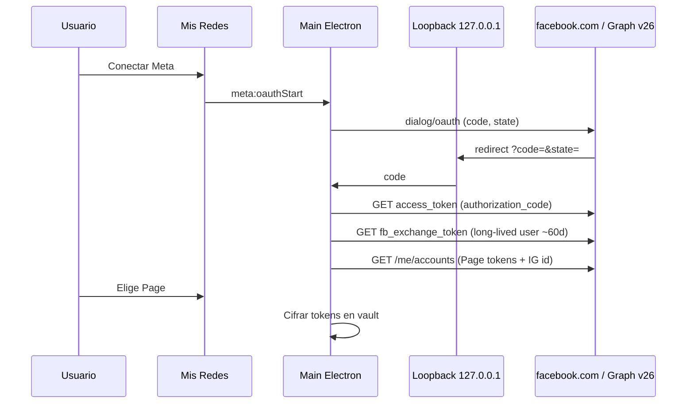

# Grok — Resultado conexión redes BabelDesk (30-sep-2026)

**Input:** `GROK_PROMPT_CONEXION_REDES_SOCIALES.md`  
**Spec machine-readable:** [`babeldesk-social-connect-spec.json`](./babeldesk-social-connect-spec.json)  
**Implementación:** solo Cursor cuando Pablo diga **«aplica P0»** / **«aplica P1»** (Hobby local, sin deploy).

---

## Resumen ejecutivo

- **Hoy:** formulario manual (token + IDs). **No OAuth.** IG con mp4 local funciona; Page video/reel pendiente (TODO en código).
- **Grupos FB:** **solo assist** — Graph para publicar en grupos **retirado** (abr 2024). No prometer API.
- **TikTok:** OAuth desktop posible (P3); **Direct Post** requiere audit de app; sin audit = inbox / SELF_ONLY y límites estrictos.
- **Camino:** P0 UX + Probar token → P1 OAuth Meta loopback → P2 video/reels + IG → P3 TikTok (y opcional Instagram Login en graph.instagram.com).

---

## Tabla auto vs assist

| Destino | Modo | Fase |
|---------|------|------|
| FB Page texto/link/foto | Auto | P1 |
| FB Page video/Reel | Auto | P2 |
| IG profesional (vía Page) | Auto | P2 (publish); local reel ya parcial |
| IG sin Page | Opcional | P3 |
| Grupos FB | Assist | P0+ |
| TikTok | Assist → API | P3 |

---

## OAuth Meta (Electron) — secuencia

**Reglas:** `state` anti-CSRF; **app secret solo en main**; redirect registrado en app Meta: `http://127.0.0.1:{puerto}/oauth/meta/callback`.

---

## P0 — tickets para Cursor (1–2 sesiones)

| # | Ticket | Done cuando |
|---|--------|-------------|
| P0-1 | Estados en lista cuentas (`disconnected` / `connected` / `expiring` / `invalid` / `assist_only`) | Se ve en Mis Redes sin confundir 🟢/🔴 actual |
| P0-2 | Botones **Probar**, **Desconectar**; **Conectar Meta** deshabilitado o “Próximamente (P1)” + enlace “Pegar token (avanzado)” | Probar no publica; Desconectar borra `access_token_enc` |
| P0-3 | IPC `accounts:probe` → `debug_token` + `GET /{page-id}?fields=id,name` + `GET /{ig-id}?fields=id,username` | Errores 190/200/10 → mensaje ES en UI |
| P0-4 | UI **Eliminar cuenta** (`accounts:delete` ya existe) | Confirmación + refresh lista |
| P0-5 | Mostrar nombre Page, @IG, `token_expires_at` si Graph lo da | Banner “Por vencer” si &lt; 7 días |
| P0-6 | Doc `.env.example` con `STUDIO_MASTER_KEY` + placeholders P1 `META_*` | Sin secretos en repo |

**Fuera de P0:** loopback OAuth, `/video_reels`, TikTok Login Kit, cron en nube.

---

## Pablo — antes de P1

1. App **Meta for Developers** (Business), modo **Development**, tu usuario con rol.
2. **Facebook Login for Business** + redirect loopback en allowlist.
3. No pedir **App Review** hasta que P1 funcione contigo en dev.
4. Grupos: solo URLs + assist; cero expectativa Graph.
5. TikTok TT4D solo si vas a P3; sin audit no vender “post público automático”.

---

## Siguiente paso

**P0 aplicado (30-sep-2026):** Mis Redes con estados, Probar/Desconectar/Eliminar, IPC `accounts:probe` + `accounts:disconnect`, `.env.example`, test `metaProbe.test.ts`.

**P1 aplicado (30-sep-2026):** OAuth Meta loopback (`metaLoopback.ts`), Conectar/Reconectar Meta, picker de Page + IG, foto local en Page (`/photos`), user token en `refresh_token_enc`.

**P2 aplicado:** Reels Page (`video_reels` + rupload) para mp4 local.

**P3 aplicado:** OAuth TikTok PKCE, FILE_UPLOAD API, checklists `docs/META_OAUTH_CHECKLIST.md` y `docs/TIKTOK_OAUTH_CHECKLIST.md`.
