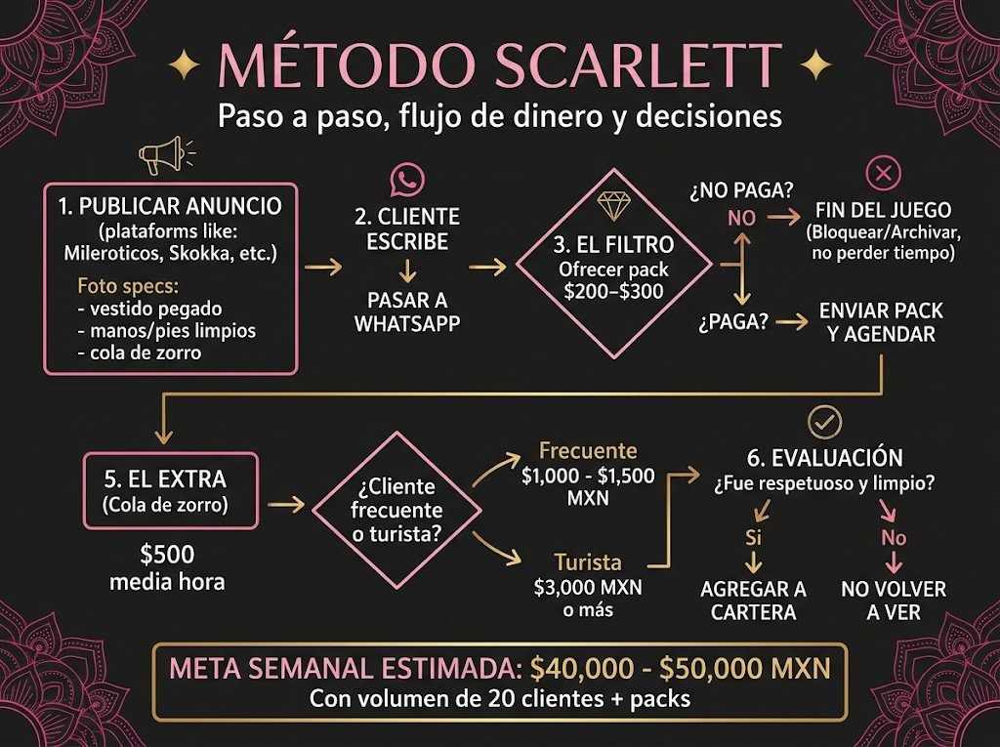

# Capítulo 1 — Disclaimer y Presentación

## AVISO LEGAL Y EDITORIAL (+18)

> **Esta obra es una crónica testimonial y literaria publicada bajo el seudónimo de *Scarlett*, protegida por los artículos 6º y 7º de la Constitución Política de los Estados Unidos Mexicanos (libertad de expresión e imprenta).** Su contenido es estrictamente informativo y recreativo para personas mayores de edad, sin constituir asesoría legal, médica, fiscal ni invitación, reclutamiento o intermediación para actividad alguna. La editorial y su autor rechazan categóricamente cualquier forma de explotación, coacción o participación de menores de edad, siendo cada lector(a) adulto(a) el único y exclusivo responsable de sus decisiones personales y del cumplimiento de las leyes vigentes en su jurisdicción. **La voz narrativa no presta servicios, no gestiona clientes de terceras y no existe canal de contacto oficial asociado a este texto.** No hay relación laboral, societaria ni de contacto directo entre quien narra y quien adquiere el ejemplar.

---

## DISCLAIMER

### Léelo antes de pasar a lo bueno

Quiero que empecemos esto con las cartas sobre la mesa, de mujer a mujer.

Todo lo que encuentres en estas páginas está basado única y exclusivamente en **mi experiencia personal**, mis tropiezos y las estrategias que **a mí** me funcionaron durante años de trabajo independiente. Esto **no** representa una asesoría legal, contable, médica ni psicológica. Cada cabeza es un mundo, cada ciudad se mueve a su propio ritmo y las circunstancias de cada una son distintas.

No vengo a prometerte que te vas a hacer millonaria de la noche a la mañana ni que tu vida se va a solucionar sola. Los resultados dependen de tu criterio, tu disciplina, el empeño que le pongas a tu imagen y, sobre todo, de cómo cuides tu seguridad.

Aquí te comparto herramientas prácticas de marketing digital, administración básica, comunicación, manejo de imagen y límites personales. Lo que decidas hacer con esta información corre bajo tu entera responsabilidad y criterio. Eres una mujer adulta, dueña de tus decisiones y de tu cuerpo. Si algo de lo que leas aquí no resuena contigo, con tus valores o con tu momento de vida, simplemente déjalo pasar. Nadie te obliga a nada.

Léelo con calma, toma lo que te sirva para crecer y cuídate siempre.

Besos,  
**Scarlett**

---

## Hola, soy Scarlett

### Mi historia, mis errores y por qué te escribo esto

Hola, bonita. Qué gusto saludarte.

Tengo 40 años bien vividos, bien gozados y, sobre todo, bien aprendidos. Si hoy me ves tranquila, segura de mí misma y dedicada al modelaje independiente —que siempre fue una de mis pasiones y que hoy disfruto gracias a los recursos y la estabilidad que logré construir—, no es porque la vida me lo haya regalado en bandeja de plata.

Vivo en Estados Unidos desde hace un tiempo y viajo mucho, pero antes de eso recorrí gran parte de México trabajando. Estuve en Ciudad de México, Guadalajara, Monterrey, Cancún, Puerto Vallarta y otras ciudades. Cada lugar se mueve distinto, y eso me enseñó mucho.

Hace años empecé desde abajo. Fui edecán en eventos masivos, modelo para marcas locales y hostess en restaurantes y antros. Estaba parada diez o doce horas con tacones de aguja por un sueldo que apenas me alcanzaba para pagar la renta de un departamento modesto, los gastos del día y algo de ropa. Veía pasar dinero a manos llenas alrededor de mí, mientras yo terminaba con los pies destrozados y la cuenta en ceros a fin de quincena.

Un día me cansé del cansancio. Me di cuenta de que tenía presencia, carisma, facilidad de palabra y que sabía conectar con la gente. Decidí dar el paso al acompañamiento independiente. No te voy a mentir: al principio me dio miedo. Nadie te enseña este negocio. No hay una escuela, no hay un libro de bienvenida ni una tía que se siente a explicarte cómo se cobra, cómo se filtra a la gente o cómo se cuida una en la calle.

### Los tropiezos del inicio

Al inicio cometí **todos los errores típicos** que casi todas cometemos cuando empezamos a ciegas:

- **Creí en promesas** de hombres que decían que me iban a resolver la vida y que “ya casi” me ponían un departamento.
- **Cobré tarifas mal planeadas** por pena, por urgencia o por miedo a quedarme sin trabajo esa semana.
- **Perdí tardes enteras** contestando mensajes de curiosos que solo querían platicar gratis, sacarme conversación caliente o pedir fotos sin intención real de pagar un peso.
- **Fui a citas a ciegas** sin pedir garantías, sin anticipo y sin verificar dónde me estaba metiendo.

Tuve suerte, sí, pero también entendí rápido que en este medio **la suerte no es un plan de trabajo**. Si quería que esto fuera redituable y no me desgastara el alma, tenía que tratarlo como lo que es: un negocio independiente de servicios y atención personalizada.

### Lo que gané (más allá del dinero)

Empecé a pulir mis números, mis filtros y mi presentación. Con el paso de los años no solo logré facturar sumas que jamás imaginé en mis épocas de edecán —llegué a facturar varios millones en mis mejores años—; aprendí algo todavía más valioso:

- Conocí a fondo la **psicología masculina** y qué hace que un hombre te trate como reina en lugar de ponerse pesado.
- Descubrí mi propia **sensualidad sin culpas**, conocí mi cuerpo y entendí qué sí me gusta y qué no.
- Exploré mis **talentos y dones** para comunicar, negociar, vender y construir una marca personal (herramientas que sirven igual si mañana quieres ser modelo, creadora de contenido, influencer o dueña de tu propio negocio).
- Y sí, bonita: en el camino también conocí **hombres buenos**, caballeros educados, limpios y generosos con los que se puede construir un trato cordial o incluso una relación bonita si tú así lo quieres. No todo en este mundo es oscuro cuando sabes **filtrar a los hombres**.

Hoy que miro hacia atrás desde mis cuatro décadas, veo a muchísimas mujeres jóvenes cometiendo exactamente los mismos errores que yo cometí hace quince años. Las veo regalando su tiempo, batallando con tipos que les regatean 200 pesos, angustiadas porque no saben cómo separar su vida privada de sus anuncios, o creyendo erróneamente que para ganar bien hay que aguantar malos tratos.

Créeme, no tiene por qué ser así.

### Las tres llaves antes de empezar

No necesitas pasar por malas experiencias ni perder meses regalando tu energía para aprender a cobrar bien y trabajar segura. El verdadero secreto para destacar y construir una base de clientes estables y respetuosos no tiene que ver con desnudarte más rápido ni con ser sumisa. Todo lo contrario:

1. **Higiene y presencia impecables:** La limpieza en piel, manos y pies comunica estatus antes de que abras la boca. Y ojo con el perfume: más adelante te explico.
2. **Aprende a escuchar y proyectar tu historia:** Muchos hombres pagan y regresan por una mujer cálida, inteligente y con una historia que inspira respeto, **no** por quien solo mira el reloj para irse: servicio a la carrera, mente en el billete y, aunque aún no se acaba el tiempo, ya con un pie en la puerta.
3. **Marca límites con elegancia:** Ni sumisa ni agresiva. No necesitas pelear ni gritar. Quien no cumple tu filtro o no respeta tus reglas, simplemente no califica para tu tiempo. Se le desea buen día y se le bloquea sin drama.

---

## El Método Scarlett — Visión general y mapa de dinero

Así funcionaba **mi** embudo cuando lo tenía pulido (cada quien define sus números y su plaza):

1. **Yo publicaba** en plataformas de anuncios donde ya había tráfico en mi ciudad (por ejemplo Mileroticos, Skokka, Locanto o MundoSexAnuncio) con 5 o 6 fotos estratégicas (vestido pegado, pies/manos limpios y el detalle de la cola de zorro).
2. **Cuando me escribían**, los pasaba de inmediato a **WhatsApp** (número de trabajo, separado de mi vida personal).
3. **Lo que yo hacía era filtrar:** ofrecía mi pack de bienvenida por **alrededor de $200–$300 MXN** antes de soltar ubicación o agenda — en mi caso, fotos y videos de cortesía que no regalaba en el anuncio público.
4. **Si no pagaba el pack**, cerraba ahí. Era curioso; bloqueaba o archivaba sin perder tiempo.
5. **Si sí pagaba**, enviaba el pack y **solo entonces** agendaba la cita presencial. En mi experiencia sostuve una tarifa base de **alrededor de $500 MXN la media hora**, cobrada por adelantado; cada mujer negocia lo suyo.
6. **En la cita** llegaba con **mi juguete estrella** —la cola de zorro— (más adelante cuento el orden: tapón chico de camino y el cambio frente a él). El impacto visual hacía que **él** pidiera el extra de anal; yo manejaba rangos de **$1,000–$1,500 MXN** con clientes de cartera y **$3,000 MXN o más** con turistas o de una sola vez — no promesas, solo lo que me pagaron en su momento. Si el miedo te dice *“me voy a quedar floja”*, es cuento urbano: en el **Capítulo 6** lo desmontamos.
7. **Al cerrar**, evaluaba: ¿fue limpio, puntual y respetuoso? Si sí, entraba a mi **cartera**; si no, no lo volvía a ver.

*(Nota: Esquema ilustrativo del flujo operativo y metas de mis mejores semanas; se presenta como referencia biográfica y no como garantía de ingresos.)*

Eso es todo. No es magia: **es un filtro de energía y un sistema de volumen inteligente**.

Después de dominarlo, tú decides cómo seguir:
- Puedes quedarte **solo vendiendo packs** desde tu casa si un día no quieres salir.
- Puedes hacer **servicios presenciales** con volumen y clientes tranquilos.
- Puedes armar tu **cartera fija** de 5 a 15 hombres que te busquen o te depositen cada semana.

Cada quien es libre de cómo trabajar.
