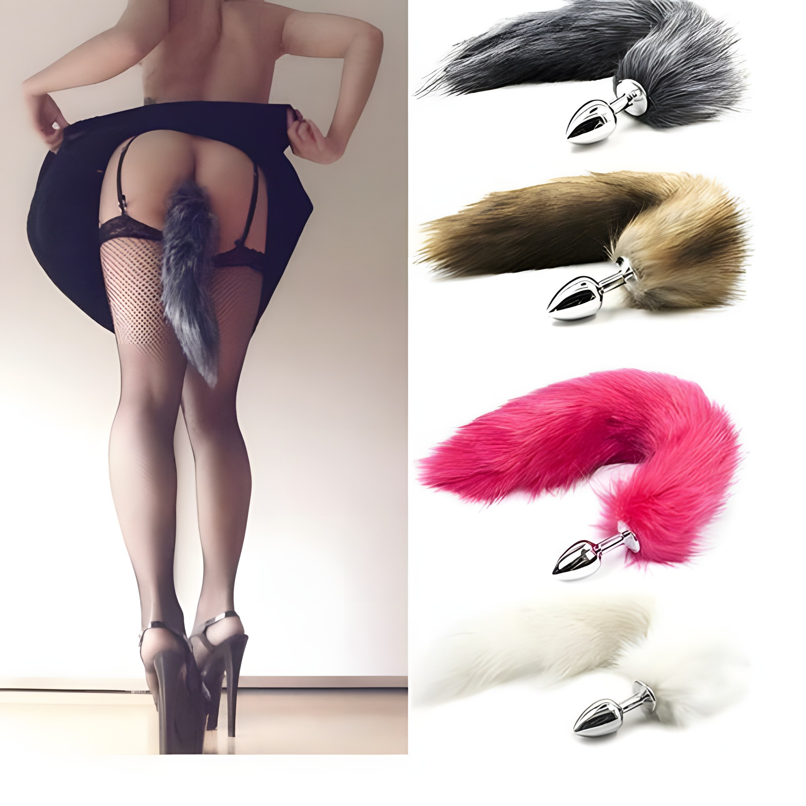
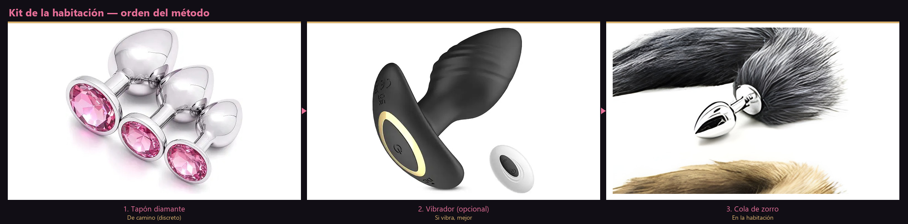

# Capítulo 6 — El Dildo Cola de Zorro, Menú de Extras y la Matemática de los $40k–$50k

## El detalle que cambió todo para mí

Bonita, quiero contarte algo que me costó años y cientos de citas entender.

Al principio yo pensaba que lo que hacía que un hombre soltara más dinero y regresara vuelto loco era comprarme lencería carísima de boutique, usar perfumes importados o ser la mujer más espectacular de toda la plataforma. **Mentira.** Después de mucho observar qué los prendía de verdad en la vida real, descubrí que lo que más dinero me hacía ganar —y más rápido— era un accesorio pequeño, juguetón y baratísimo: **el dildo (plug) cola de zorro**.

No te asustes si nunca has usado uno. No es un aparato monstruoso ni nada del otro mundo: es un tapón anal pequeño, liso, en forma de gota, que por fuera tiene una colita de peluche (de zorro, de colores, blanca o negra). Lo consigues en cualquier sex shop, en Mercado Libre, Amazon o hasta en puestos discretos de tianguis por muy poco dinero. Pero **casi ninguna chica en las plataformas sabe usarlo como herramienta de ventas**, y ahí es donde tú te llevas todo el pastel.

Elige el color que combine con tu vestido o short (gris, café, rosa, blanco…). En fotos del anuncio basta con que se **asome**; el show completo es en la habitación, como te platico abajo.

---

## Cómo funciona la psicología del gancho (del anuncio a la cama)

El secreto se divide en dos tiempos:

### 1. En las fotos del anuncio y del pack
Como vimos en el Capítulo 2, en una o dos de tus fotos sales con tu vestido pegado o tu short de mezclilla cachetero (con un hoyito discreto hecho a propósito) dejando que la cola de zorro se asome. Eso siembra la fantasía en la mente del cliente desde que está viendo su celular. Él no ve un anuncio aburrido más: ve una fantasía visual.

### 2. En la habitación (el momento del Upsell automático)

En el banner de arriba, de izquierda a derecha: **1** tapón de camino · **2** vibrador si lo usas · **3** cola de zorro **solo en la habitación**, después de cobrar. No mezcles el orden.

Cuando vas a una cita presencial, en tu cosmetiquera llevas siempre **tres cosas**:
1. Un **plug pequeño tipo diamante** (el más chiquito y delgado; si puedes, **vibrador** — mejor para ir entrando en calor y estimular el ano sin forzar).
2. Tu **plug cola de zorro** (va en la bolsa; **no** viajas con la cola puesta en el Uber ni en la calle).
3. Un buen **lubricante a base de agua o silicón** (nunca escatimes; es tu mejor amigo para no lastimarte).

**Orden real del método (no te adelantes):**

1. **De camino / antes de entrar:** con lubricante te pones solo el **tapón diamante** (discreto, sin cola). Si vibra suave, mejor: ayuda a que circule la sangre en la pelvis, baja el nervio del trayecto y **educa al músculo** para que llegue relajado — entrar en calor sin forzar.
2. **En la habitación:** saludas, cobras tus **$500 de base** y dejas el dinero guardado.
3. **El show del cambio:** frente a él —con calma y sin pena— te cambias a lencería o te acomodas. De forma sensual **sacas el tapón chico** y, ahí mismo, te colocas la **cola de zorro** con abundante lubricante. Como la zona ya viene preparada desde el camino, la cola entra suave; él ve el reemplazo y se prende más que si salieras del baño ya “lista” a escondidas.
4. Te das la vuelta o te acomodas en doggy: el impacto visual es inmediato.

**Seguridad de juguete:** todo lo que entre por atrás debe tener **base ancha** (diamante o cola). El recto puede “succionar” objetos sin tope; esa regla no se negocia.

Qué ganas con eso:
- Si solo contrataron el **precio base de $500**, **muchos terminan más rápido** (10–15 minutos), sin desgastarte media hora entera.
- Con la **cola de zorro** puesta (después del cambio frente a él), **casi todos te van a pedir sexo anal**. Es obvio: ya vio el show y, como lo dejaste claro en tu menú y en el anuncio, **sabe que el anal lleva un precio extra desde $1,000 pesos hacia arriba** ($1,000–$1,500 si es de cartera; **$3,000+** si es turista), encima de tus $500 de base. Tú no lo ruegas ni lo gritas: **él lo pide** y paga con gusto. Ahí cosechas el fruto de tu trabajo.

---

## Upsell y menú: cobrar más sin pelear ni parecer desesperada

Hay una línea delgada entre **profesional que sabe lo que vale** y vendedora que atosiga. En CDMX y Guadalajara yo, apenas entraba el cliente, soltaba precios: *“esto cuesta tanto, lo otro el doble”*. Rompía la magia; él se sentía en refacciones, regateaba o se ponía tosco.

Un cliente fijo en **Puerto Vallarta**, señor de bienes raíces, me dijo: *“Scarlett, a los hombres nos encanta comprar, pero odiamos que nos vendan”*. Ahí entendí el *upsell* elegante: **escenario perfecto, antojo, y que sea él quien pida**. Cuando pide, paga con gusto.

---

### Regla de oro: el base de $500 impecable

Antes de un peso de extra: **tu media hora base no es muestra gratis**. Nunca des servicio frío o con cara de disgusto para “forzar” upsell — te disparas en el pie.

Quien pagó pack ($200–$300) y **$500 al entrar** recibe trato dulce, limpio, oral y vaginal con condón, contacto visual, plática cálida. Si se va feliz solo con base, **ganaste cartera**. La confianza hace que él solo quiera explorar extras contigo. Base = semilla; extras = cosecha.

Cuando ya cobraste el pack y los **$500 de base**, **ese fue el trato** — respétalo. Entrega la media hora que prometiste con buena actitud; no regatees ni subas el base en la habitación, **sobre todo ya desnudos**: eso sí molesta y rompe la confianza. Lo que cuesta más (anal u otro extra) va **aparte**, con el precio de tu menú, y **solo cuando él lo pide**; no lo empujes porque ese día te urge la renta. El base te deja en paz; el extra es lo que **se suma** cuando la cita ya iba bien.

---

### Tú no ofreces — que lo pida él

En el anuncio y en la habitación **no vendes anal a gritos** ni sueltas precios en cuanto entra. Tú pones el escenario (fotos, cola, cambio frente a él) y cumples el base; **el extra lo abre él**. Casi siempre pasa igual: vio el cambio, toca la colita y pregunta *“¿y se puede por ahí?”*. Ahí sí respondes, con calma y tabulador claro — sonríe, acaricia mejilla o cuello, y cobras sin titubear:

**Cliente local educado (cartera fija):**

> *“Claro, mi rey, me encanta consentirte… ese servicio requiere más cuidado. Normalmente lo cobro más alto, pero contigo, tan caballero, **te lo dejo en $1,200 adicionales** (rango **$1,000–$1,500** en tu plaza). Deja mi dinero en el buró y disfrutamos sin prisas.”*

**Turista, extranjero o cita única** (Cancún, Vallarta, Cabos, Polanco/Reforma):

> *“Por supuesto, corazón. Es mi especialidad más exclusiva: **$3,000 adicionales** (o $150–$200 USD). ¿Lo dejamos listo?”*

Si hoy no alcanza: *“No te preocupes, mi amor, con el base la pasamos riquísimo”* — media hora con la mejor actitud, cero drama.

---

### Los rangos que yo manejé y cómo los planteaba

*Referencia de **mi** época en CDMX, GDL y plazas turísticas; no es catálogo para terceras — cada mujer define sus números y su plaza.*

| Concepto | Lo que yo cobraba (MXN) | Cómo lo decía yo en la práctica |
|----------|-------------------------|----------------------------------|
| **Pack filtro (WhatsApp)** | **$200 – $300** | Solo después del pack compartía ubicación o cita. |
| **Servicio base (30 min)** | **~$500** | Al entrar; trato cariñoso, íntimo **con preservativo** — eso no negociaba. |
| **Tiempo extra (15–20 min)** | **+$300 – $500** | Si pedía un ratito más sin media hora completa, **yo nombraba el extra antes** de seguir. |
| **Media hora adicional** | **+$500** | Si faltaban minutos y no quería irse: *“Amor, otra media hora con calma son otros $500”* — frase que a mí me funcionó. |
| **Extra anal (cartera)** | **+$1,000 – $1,500** | Cuando **él** lo pedía (cola de zorro); lubricante a base de agua; **yo cobraba antes** de retirar el plug. |
| **Extra anal (turista / ocasión)** | **+$3,000+** | En temporadas turísticas o clientes de paso pedía más; dependía de la plaza. |
| **Fetiche de pies** | **+$500 – $800** | Con pedicure impecable (Cap. 2); poco desgaste físico para mí. |
| **Lencería / rol suave / antifaz** | **+$800 – $1,500** | Alineado a mi Avatar (Cap. 4); **precio antes** de hacerlo. |
| **Otros (trío, caprichos fuera de menú)** | **Variable** | Solo si estaba en mi lista de “Sí” (Cap. 8). |

---

### Menú con cabeza fría: cobra el extra que cierra la cita

Aquí cuento cómo **yo cosechaba** con la cola y el anal cuando él pedía — ahí estaba, para mí, el billete gordo. La tabla de arriba también trae **plan B de lujo** por si un día el extra anal no entra en juego: **tiempo extra** (otra media hora ~$500, hora ~$1,000), **pies limpios** o **más packs desde casa**. Son complementos, no excusas para apagar el método.

**Hoy no es día de extra anal** (ciclo, cansancio real, malestar) — sin drama: voz dulce *“Ay mi rey, hoy traigo molestia y ese servicio no puedo; ven que te dejo como nuevo con mis manos y el base”*, cobras tu $500 impecable y **mañana vuelves al menú completo**. Cliente limpio pero sin confianza todavía: igual, base redondo primero; el anal llega cuando ya te conoce.

Con packs y volumen ya traes miles a la semana; **los extras son crema encima del base**.

El excedente de un extra ($1,200 o $3,000) son minutos dentro de la misma cita — **sepáralo para patrimonio** (Cap. 8), no para bolsas de fin de semana. Cobra con elegancia y cabeza fría.

### Dudas que me preguntan (y que el miedo inventa)

*"Scarlett, ¿el plug o el anal me van a dejar el ano flojo? ¿Se me va a salir la caca al caminar?"*

**No, bonita. Eso es cuento urbano.** El esfínter es un anillo de músculo elástico —como cuando vas al baño—: si estás relajada, con lubricante y sin fuerza bruta, cede un rato y **vuelve a cerrarse solo** cuando retiras el juguete. Quien se lastima de verdad es quien lo hace en seco, a lo bruto o sin preparación: el cuerpo se cierra como candado y ahí vienen el roce y el dolor. Por eso **nosotras** llevamos el control con nuestro tapón chico, nuestra cola y nuestro lubricante; no dejamos que un hombre “entre a ciegas” y te arruine la semana.

Esto no es magia ni promesa de doctora: es cómo responde un cuerpo cuidado, paso a paso. Si un día hay dolor fuerte o sangre, paras (Cap. 7).

**Resumen claro (quédate con esto):**

1. **Camino:** tapón diamante (vibración suave ayuda); **habitación:** cambio a cola con lubricante — no llegues con la cola ya puesta.
2. **Juguete:** siempre **base ancha**; atrás **no hay lubricación natural** — lleva gel a base de agua.
3. **Mito:** el esfínter **vuelve a cerrar** cuando retiras el plug; el desastre es fricción en seco o brusquedad.
4. **Límite:** dolor punzante, ardor que no cede o sangre = **paras** y consulta (Cap. 7).

---

## Por qué el modelo de $500 base + extras le gana a cobrar carísimo de entrada

Quiero que entiendas la lógica financiera detrás de esto, porque es donde la mayoría se equivoca.

Muchas chicas entran a las páginas queriendo cobrar **$2,000, $3,000 o $3,500 pesos de entrada** por una hora sin que nadie las conozca. ¿Qué pasa en la práctica?
1. Se pasan **días enteros sin que les caiga un solo cliente** porque la competencia es enorme.
2. Cuando por fin cae uno que paga $3,000 de golpe, muchas veces es un tipo que llega con la mentalidad de **"tengo que desquitar cada peso que pagué"**: te exige posiciones incómodas, quiere durar los 60 minutos exactos dándote duro, se pone mandón, tosco o grosero. Y tú sales de esa cita adolorida, drenada y pensando que este trabajo es un infierno.

Con mi esquema de **$500 la media hora + filtro de pack + extra de anal ($1,000–$1,500)** logras exactamente lo contrario:
- El cliente siente que el acceso presencial es una ganga por haber comprado tu pack.
- Como es media hora y ya viene excitado por las fotos y la cola de zorro, **la cita es rápida, ligera y sin desgaste físico extremo**.
- Si pide el anal, en esos mismos 25–30 minutos ya te embolsaste **$1,500 a $2,000 pesos en total** ($500 base + $1,000/$1,500 extra), ¡lo mismo o más que la chica que aguantó una hora entera a un cliente pesado, pero tú lo hiciste en la mitad de tiempo y con un hombre agradecido!
- Y lo mejor: **conservas solo a los clientes limpios, educados y hasta románticos**, porque tienes volumen de sobra para darte el lujo de bloquear a cualquier grosero.

---

## La matemática de mis mejores semanas con el método

Para que veas con números claros de dónde sale la meta de **$40,000 a $50,000 MXN semanales** cuando trabajas con constancia y volumen (aproximadamente 20 citas a la semana, que son unas 3 citas al día descansando un día):

| Concepto de ingreso | Cálculo semanal | Total aproximado (MXN) |
|---------------------|-----------------|------------------------|
| **1. Venta de Packs (Filtro diario)** | 10 packs al día × 7 días × $200 | **$14,000** |
| **2. Servicios Base (30 min)** | 20 clientes a la semana × $500 | **$10,000** |
| **3. Extras de Anal (promedio conservador)** | 20 extras × $1,000 promedio | **$20,000** |
| **TOTAL SEMANAL ESTIMADO** | *(Sin contar propinas ni turistas de $3,000)* | **$44,000 MXN** *(rango $40k – $50k)* |

Haz la cuenta con calma: en **un mes constante** con ese volumen cierras alrededor de **$160,000–$200,000 pesos**. En **un año** con el mismo ritmo hablamos de **casi 2 millones de pesos** (entre **$1.9 y $2.4 millones MXN**, según semanas y extras). Administrado (sin fiestas ni vagos) hay margen real para carro, enganche de casa o un negocio propio — detalles de **para qué** el dinero: Cap. 8.

**Ojo con el primer mes:** no te desanimes si la primera o segunda semana cierras con **cuatro o seis mil pesos** en lugar de cuarenta mil. El volumen no nace en tres días: toma un par de semanas afilar WhatsApp, fotos y tus primeros recurrentes. Cuatro mil en tu bolsa desde la primera semana **ya es dinero tuyo**, ganado con la cabeza y sin rendirle cuentas a nadie. La tabla de arriba es meta con constancia, no promesa del día uno.

---

## Trucos de intimidad: terminar más rápido y quedar contento

Bonita, acércate: hablemos de lo que pasa dentro de esas cuatro paredes, sin pena ni mitos.

Cuando empecé —CDMX, Guadalajara— creía que ser “buena en la cama” era acrobacia, aguantar horas o gritar como actriz de película. Me desgastaba por los mismos $500 o $1,000: mandíbula acalambrada, espalda adolorida. Hasta que en Monterrey, con un cliente que no terminaba porque traía la oficina en la cabeza, entendí la regla que cambió mi economía: **no lo haces terminar a fuerza bruta; lo haces gobernando mente, sentidos y ritmo**.

El servicio base de **$500 por media hora** no es para vivir en el colchón. El método es **volumen inteligente**: entrar fresca, conectar, cobrar extras bien puestos y salir airosa, con él fascinado y con ganas de volver. Aquí van las llaves para trabajar **menos con el cuerpo y más con la cabeza**.

---

### La mente masculina: orden y cuatro pilares

El error número uno es el **desorden**: caricias, cambio de ritmo a los diez segundos, pausa por lubricante, otra postura… Para su cerebro es prender y apagar el switch. No se concentra, la erección falla y la cita se alarga sin necesidad.

Desde que entran a la cama, apunta estos cuatro pilares:

### 1. Contacto visual sostenido (al inicio)

En los primeros minutos —masaje suave, juego previo con condón o beso en el cuello— **míralo dos o tres segundos seguidos con media sonrisa pícara**. Muchos están acostumbrados a miradas al techo o cara de aburrimiento. Cuando siente que de verdad lo disfrutas, el ego sube y la excitación se dispara antes de la acción fuerte.

### 2. Ritmo constante (secreto de oro)

**Cuando algo le gusta, no lo cambies.** Señales: respiración entrecortada, ojos cerrados, aprieta tus caderas. Ahí muchas aceleran o cambian postura —error. Misma velocidad, misma presión, misma profundidad. Ese ritmo parejo lo lleva al clímax sin retroceder.

### 3. Foco en la punta y manos lubricadas

En oral con condón o manual, la sensibilidad está en el **glande y el frenillo**. No te mates empujando hasta la garganta. Mano bien lubricada (a base de agua, siempre a la mano) en la base; boca arriba, succión suave. Más placer para él, menos desgaste para ti.

### 4. Frases al oído (*dirty talk* elegante)

Sin majaderías forzadas si no van contigo. Voz baja, cerquita del oído:

* *“Qué delicia te sientes, amor.”*
* *“Me encanta cómo me tocas.”*
* Cuando ya está al límite, el gatillo que casi nunca falla: **“Ven para mí, mi rey… dámelo todo aquí.”**

Ese *“ven para mí”* suena a permiso de entregarse; muchos descargan en segundos.

---

### Cola de zorro en acción: doggy y el extra

La venta del anal **no se grita en el anuncio**; se siembra en fotos (Cap. 2) y florece cuando él ve el cambio a la cola (arriba). Perfume solo si él quiere (cuida a los casados). La postura reina es **doggy** — codos o pecho en almohadas:

* **Control:** tú manejas ángulo, rodillas y espalda; evitas empujones incómodos.
* **Visual:** cadera, espalda arqueada, cola moviéndose con el vaivén; muchos que solo pagaron base terminan en quince minutos fascinados.
* **Upsell:** casi siempre toca la colita y pregunta *“¿y se puede por ahí?”* — cobras el **extra de tu tabulador** (arriba en este capítulo), lubricante abundante, retiras el plug despacio. Zona ya relajada; media hora puede dejarte $1,700–$2,000 total, sin forcejeos.

---

### Leer al cliente sin perder tus límites

Tres perfiles comunes:

1. **Tímido o apresurado:** Poco habla, nervioso por trabajo o familia. Dulzura, caricia en espalda, música suave, condón con calma, contacto visual. Termina rápido y agradecido.
2. **Conversador que necesita oído:** Diez minutos de escucha activa mientras juegas manos o pies limpios; luego cama y se entrega feliz.
3. **Tosco o ansioso:** Quiere brusquedades o cambiar a cada rato. No te achiques: bajas su mano, voz tranquila — *“Despacio, corazón, sin prisas, así se disfruta más rico”*. Tú mandas en tu cuerpo.

**Ojo:** que quieras que termine contento **no** significa cruzar tu lista de “Mis Sí y Mis No” (Cap. 8). Sin condón, prácticas que te den asco o vibra mala — no se negocia. Con packs y volumen, no aguantas caprichos pesados.

---

### Para qué sirve dominar esto (sin perder el norte)

1. **Energía:** 20–25 minutos efectivos vs. una hora pesada → más citas al día, cuerpo entero.
2. **Cartera:** Cliente educado que termina bien, huele tu limpieza y vio la cola vuelve los jueves con depósito.
3. **Dinero con rumbo:** la meta semanal del método no es para humo ni antros — **Cap. 8**.

Todo en este capítulo es **opcional**: un día puedes ir solo base + pies + packs. Tú eres dueña del menú y de tu intimidad.

Besos,  
**Scarlett**
