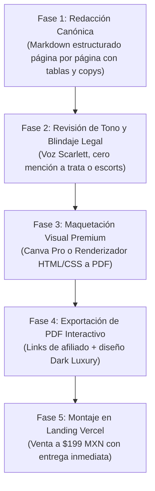

# 11 — GUÍA EDITORIAL: TONO, NARRATIVA DEL FUTURO Y ARQUITECTURA VISUAL

**Propósito:** Definir con precisión quirúrgica el tono de comunicación, los argumentos macroeconómicos de urgencia (el fin del trabajo tradicional y del dinero físico), el vocabulario de poder y las directrices visuales (diagramas, tablas, flujos) para que el Playbook de 35 páginas ($199 MXN) se perciba como un reporte de consultoría confidencial de $1,000 USD.

---

## 1. LA TESIS DEL FUTURO INMINENTE (EL "WHY NOW?" DE LA LECTORA)

Para que la lectora sienta que este libro es un salvavidas y una revelación inevitable, la narrativa debe sostenerse sobre tres pilares macroeconómicos verificables:

### A. La Trampa del Título Universitario y la Precarización Femenina
- **La Realidad Cruda:** En México y Latinoamérica, un título universitario de 5 años cuesta miles de horas y colegiaturas para desembocar en empleos de oficina con sueldos de **$8,000 a $12,000 MXN mensuales** ($400 a $600 USD), soportando 3 horas diarias de transporte público inseguro, acoso y jefes mediocres.
- **El Impacto de la Inteligencia Artificial (Dato Duro):** Según reportes del Foro Económico Mundial (*Future of Jobs Report*) y Goldman Sachs, más del **45% de los puestos administrativos, de servicio al cliente y redacción básica —ocupados históricamente por mujeres jóvenes— serán automatizados antes de 2030**.
- **El Mensaje Clave:** *«El título universitario colgado en la pared ya no garantiza tu renta ni tu libertad. El mercado tradicional te exige tu juventud a cambio de sueldos en pesos devaluados. La verdadera soberanía femenina hoy no es competir contra un algoritmo en una oficina; es monetizar directamente la atención global en dólares desde tu propio espacio».*

### B. La Muerte del Dinero Físico y la Economía 100% Digital
- **Transición a Economías Sin Efectivo:** El dinero en efectivo va en retirada; la economía global es de bits, tarjetas digitales, criptoactivos y pasarelas transfronterizas (Stripe, DolarApp, Throne, Paxum).
- **El Arbitraje Geográfico:** La moneda mexicana o latinoamericana compra cada vez menos canasta básica debido a la inflación. En cambio, ganar en **Dólares ($USD)** gastando en **Pesos ($MXN)** es el hack financiero definitivo: $35 USD ganados en 45 minutos equivalen a casi dos días de salario mínimo en México.

### C. La Economía de Creadores Anónimos (Faceless Creator Economy)
- **El Cambio de Paradigma:** No necesitas ser una figura pública, ni actriz, ni influencer expuesta al escrutinio social de tu familia. El anonimato no es vergüenza; es **estrategia corporativa de nicho**.
- **La Fantasía Kemonomimi / Kitsune:** La industria del cosplay y anime mueve más de **$30,000 millones de dólares anuales**. Los hombres de EE.UU., Canadá y Europa no buscan pornografía vulgar que abunda gratis en internet; buscan **conexión sensorial, misterio, voz dulce y el rol de consentir a una criatura mística**.

---

## 2. VOCABULARIO Y DICCIONARIO DE PODER (CÓMO HABLARLE A LA LECTORA)

El libro **jamás** debe usar vocabulario de autocompasión, lástima, marginación ni pornografía vulgar. La voz narrativa es la de una **mentora de élite, hermana mayor sagaz, elegante, calculadora y protectora**.

| Término Prohibido / Vulgar | Término de Poder Oficial en el Playbook | Significado Psicológico para la Lectora |
|---|---|---|
| "Venderse por internet" | **Monetización de la Atención Digital** | Se percibe como un activo de negocios, no como un acto de degradación. |
| "Enseñar el cuerpo" | **Arquitectura de Seducción Visual y Cinemática** | Es un arte de encuadres, sombras, textura y ángulos de cámara. |
| "Clientes / Puteros" | **Patrocinadores / Coleccionistas / Whales** | Eleva el estatus del comprador a quien financia el personaje. |
| "Miedo a que me descubran" | **Protocolos Militares de OpSec y Anonimato** | Convierte el miedo en una ventaja técnica metódica. |
| "Trabajo sucio" | **Arbitraje Financiero en Dólares** | Desplaza el juicio moral hacia una jugada económica inteligente. |
| "Camming / Putería" | **Transmisión de Personaje / Performance Kemonomimi** | El foco es la actuación, el cosplay y el misticismo del zorro. |
| "Poco dinero" | **Fase de Capital Semilla de Bajo Presupuesto** | Se trata como una empresa en crecimiento por etapas. |

---

## 3. ARQUITECTURA VISUAL: ¿POR QUÉ SON OBLIGATORIOS LOS DIAGRAMAS Y TABLAS?

> [!IMPORTANT]
> **El Secreto del Alto Valor Percibido ($199 MXN vs $1,000 USD):**  
> Si una lectora abre un documento y ve páginas interminables de párrafos en negro sobre blanco, su cerebro lo clasifica inconscientemente como *«un hilo de blog o un texto que redactó una IA gratis»*.  
> Cuando la lectora ve **diagramas de flujo tipo mapa militar, tablas comparativas con márgenes de ganancia en oro, cronogramas semanales en bloques visuales y checklists tácticos con casillas para tachar**, su cerebro lo procesa instantáneamente como **un MANUAL DE OPERACIONES CONFIDENCIAL**.

### Los 5 Tipos de Elementos Visuales Requeridos en las 35 Páginas:
1. **Diagramas de Flujo (Mapas de Dinero y Embudos):**  
   - *Ejemplo:* Del video de 7s en TikTok → Enlace anónimo en bio → Menú escalonado en Telegram/Throne → Retiro a tarjeta mexicana.
2. **Tablas de Rendimiento Financiero (Unit Economics):**  
   - Columnas claras: Inversión inicial ($MXN), Tiempo requerido, Precio de venta ($USD), Margen de beneficio neto (%).
3. **Cajas de Alerta de OpSec (Semáforos de Seguridad):**  
   - Cajas sombreadas con advertencias en rojo/dorado: *"NUNCA uses tu cuenta bancaria personal para recibir transferencias directas de fans"*.
4. **Plantillas de Guiones Desglosadas Cuadro por Cuadro:**  
   - Estilo guión de cine: Segundo 0 a 3 (Acción visual) | Segundo 4 a 7 (Audio/Texto) | Llamado a la acción.
5. **Hojas de Trabajo y Checklists de Despegue:**  
   - Listas de verificación antes de encender la cámara (luz, ángulo, geobloqueo de México activo, micrófono listo).

---

## 4. FORMATO TÉCNICO DE PRODUCCIÓN: DE MARKDOWN A PDF DE ÉXITO

### Formato Final de Entrega a la Compradora:
- **PDF Interactivo de Alta Resolución (A4 Vertical o Formato Tableta / Móvil):**
  - Es el formato universal por excelencia: se abre instantáneamente en el celular de la chica con un clic desde el correo de compra o la página de gracias.
  - Permite hipervínculos cliqueables directos a los enlaces de afiliados (Throne, Lovense, Amazon, Stripchat, CapCut).
  - No requiere que la usuaria descargue aplicaciones adicionales como Kindle o ePub.

### Flujo de Construcción Táctica (Paso a Paso):

1. **Fase 1 (En este Workspace / Claude):** Redactar los 7 bloques temáticos (5 páginas por bloque) en archivos Markdown independientes, con los textos exactos, titulares magnéticos, copys para cajas de texto y descripciones visuales para los diagramas.
2. **Fase 2 (Maquetación Visual):**
   - **Opción A (Canva):** Usar una plantilla de "Dossier / Revista Ejecutiva" con la paleta Dark Luxury (`#120E16`, Rosa `#E87099`, Oro `#D8B26E`). Se copian los textos de Markdown a las cajas prediseñadas en Canva y se colocan iconos y vectores limpios.
   - **Opción B (Generación Automatizada HTML-to-PDF):** Compilar el Markdown con la hoja de estilos de `STYLE_GUIDE.md` utilizando una herramienta de renderizado visual (Puppeteer / WeasyPrint / Marp) para producir un PDF idéntico a una revista física sin tener que arrastrar cajas a mano.
3. **Fase 3 (Verificación de Clics):** Asegurar que todos los enlaces a las herramientas y programas de afiliado sean funcionales.

