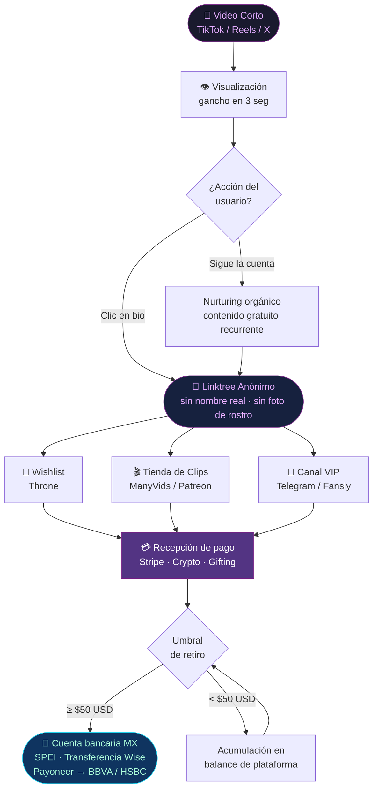

# Dossier Visual: Economía de Creadores Digitales Independientes (+18)
> Diagramas, Unit Economics y Checklists Técnicos — Generado por Claude

---

## ACTIVO 1 — EMBUDO DIGITAL (Mermaid Flowchart)

---

## ACTIVO 2 — UNIT ECONOMICS: GANANCIA POR HORA

| Tipo de Producto | Costo Insumo (MXN) | Tiempo (min) | Precio Venta (USD) | Margen Neto (%) | Ingreso/hr (USD) |
|---|---|---|---|---|---|
| Suscripción mensual | $0 | 5 (setup) | $9.99 | 72–80% | **$85+** (por suscriptor activo) |
| Pack temático (10–15 archivos) | $0–$50 | 90 | $25–$40 | 85%+ | **$18–$27** |
| Drip de contenido (chat guiado) | $0 | 30–60 | $15–$30 | 90%+ | **$22–$45** |
| Audio personalizado (3–5 min) | $0 | 20 | $12–$20 | 95% | **$36–$60** |
| Wishlist / Cash gifting | $0 | 2 | $5–$200+ | 100% | **Variable** |
| **Regla de corte mínimo** | — | — | — | — | **≥ $8 USD/hr** |

> **📌 Regla de oro:** Todo producto que genere menos de $8 USD/hr se descontinúa o se sube de precio. El tiempo es el único recurso no renovable.

---

## ACTIVO 3 — MATRIZ OPSEC DIGITAL

| Nivel | Punto de Auditoría | Herramienta / Acción | Estado |
|---|---|---|---|
| 🟢 **Bajo** | Separación de correo comercial | Gmail dedicado sin nombre real | ☐ |
| 🟢 **Bajo** | Cuenta bancaria separada | BBVA Empresarial o cuenta Payoneer | ☐ |
| 🟢 **Bajo** | Nombre de usuario | Sin iniciales reales, sin ciudad | ☐ |
| 🟡 **Medio** | Geobloqueo por país | Configurar en Fansly / ManyVids → Bloquear MX estado natal | ☐ |
| 🟡 **Medio** | Geobloqueo por IP | Restricción regional activa en cada plataforma | ☐ |
| 🟡 **Medio** | Borrado de metadatos Exif (foto) | App **Metapho** (iOS) / **Photo Exif Editor** (Android) | ☐ |
| 🟡 **Medio** | Borrado de metadatos Exif (video) | **Handbrake** (re-encode) o **ExifTool** vía terminal | ☐ |
| 🔴 **Crítico** | VPN activa con Kill Switch | **Mullvad VPN** / **ProtonVPN** — Kill Switch encendido siempre | ☐ |
| 🔴 **Crítico** | Sin filtros AR nativos en contenido de pago | Los filtros de TikTok/Instagram incrustan ID de dispositivo | ☐ |
| 🔴 **Crítico** | Verificación de identidad (plataformas) | Usar ID válida — los datos van a la plataforma, NO al comprador | ☐ |
| 🔴 **Crítico** | Auditoría mensual de huella digital | Buscar propio alias + número en Google / Yandex / TinEye | ☐ |

---

## ACTIVO 4 — CRONOGRAMA SEMANAL EN LOTE (Mermaid Gantt)

```mermaid
gantt
    title Semana de Producción · 15 hrs Totales
    dateFormat  HH:mm
    axisFormat  %H:%M

    section LUNES — Producción en Lote
    Calentamiento / Setup         :done,    l1, 10:00, 30m
    Producción masiva (fotos/video):active,  l2, 10:30, 180m
    Edición y etiquetado de lotes  :         l3, 13:30, 90m

    section MARTES — Atención VIP
    Revisión de mensajes VIP       :         m1, 18:00, 60m
    Contenido personalizado        :         m2, 19:00, 60m

    section MIÉRCOLES — Ventas Asincrónicas
    Chat de ventas / upsell        :         x1, 20:00, 90m

    section JUEVES — Live / Interacción
    Transmisión o Q&A anónima      :         j1, 19:00, 90m
    Seguimiento post-live          :         j2, 20:30, 30m

    section VIERNES — Atención VIP
    Contenido custom urgente       :         v1, 18:00, 60m
    Respuesta de chats pendientes  :         v2, 19:00, 60m

    section SÁBADO — Ventas Asincrónicas
    Chat de ventas / upsell        :         s1, 17:00, 90m
    Programación de posts          :         s2, 18:30, 30m

    section DOMINGO — Cierre y Retiro
    Revisión de métricas           :         d1, 12:00, 60m
    Retiro de fondos + registro    :         d2, 13:00, 30m
```

---

## ACTIVO 5 — DASHBOARD DE CONTROL FINANCIERO DIARIO

### Tabla de Registro Diario

| Fecha | Canal de Venta | Producto Vendido | Importe (USD) | Equiv. MXN* | Minutos | USD/hr | ¿Rentable? |
|---|---|---|---|---|---|---|---|
| 2024-01-01 | Fansly Sub | Suscripción mensual | $9.99 | $199.00 | 5 | $119.88 | ✅ |
| 2024-01-01 | ManyVids | Pack temático Vol.1 | $25.00 | $498.00 | 90 | $16.67 | ✅ |
| 2024-01-01 | Telegram VIP | Audio custom | $15.00 | $299.00 | 20 | $45.00 | ✅ |
| — | — | — | — | — | — | — | — |
| **TOTAL DÍA** | | | **$XX.XX** | **$XX.XX** | **XX** | **$XX.XX** | |

> *Tipo de cambio del día (fuente: Banxico o Wise al momento del retiro)

### Resumen Semanal (Bloque de KPIs)

| KPI | Meta Mínima | Meta Óptima | Real Semana |
|---|---|---|---|
| Ingresos brutos (USD) | $150 | $400 | — |
| Horas trabajadas | 15 | 15 | — |
| Promedio USD/hr | $10 | $26+ | — |
| Nuevas suscripciones | 3 | 10 | — |
| Productos vendidos | 5 | 20 | — |
| Retiro ejecutado (sí/no) | ✅ | ✅ | — |

