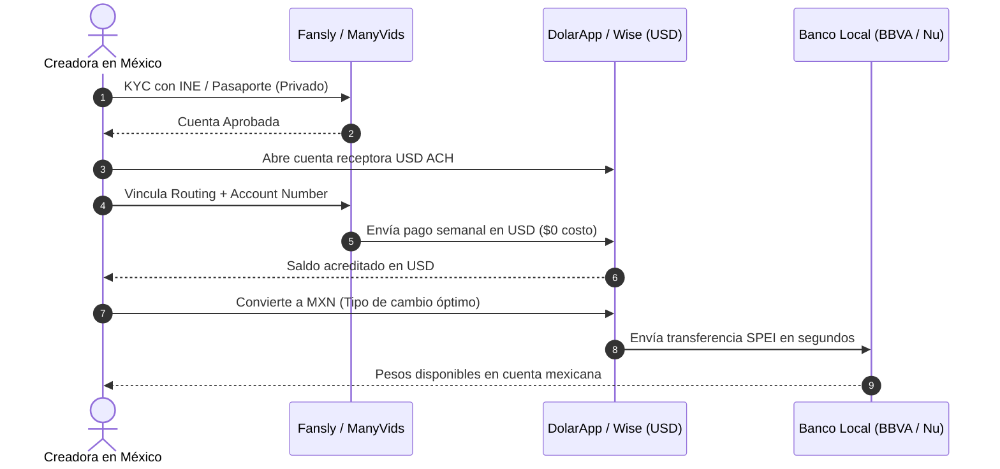

# 02 · Plataformas, Pasarelas de Pago y Arbitraje Cambiario a México
> Reporte técnico para creadoras digitales independientes que operan desde LATAM y cobran en USD.  
> Versión 1.0 · Noviembre 2026 · Generado con Claude

---

## BLOQUE 1 — TABLA COMPARATIVA DE PLATAFORMAS (+18)

> ⚠️ **Nota editorial:** Las comisiones y condiciones cambian. Verificar siempre en la página oficial antes de priorizar una plataforma. Datos validados a noviembre 2026.

| Plataforma | Modelo Principal | % Plataforma | % Neto Creadora | Frecuencia de Pago | Mínimo de Retiro | Geobloqueo Regional |
|---|---|:---:|:---:|---|:---:|:---:|
| **Fansly** | Suscripción + PPV + Tips | 20% | **80%** | Semanal (solicitud manual) | $20 USD | ✅ Sí — por país y estado |
| **ManyVids** | Tienda de clips + Suscripción | 20–40%* | **60–80%** | Semanal / Quincenal | $50 USD | ✅ Sí — por país |
| **LoyalFans** | Suscripción + Contenido exclusivo | 20% | **80%** | Diario (si cumple criterios) | $50 USD | ✅ Sí — por país |
| **Throne** | Wishlist / Gifting directo | ~5% (al comprador) | **~95%** | Inmediato (el regalo llega físicamente) | N/A | ⚠️ Limitado |
| **Stripchat** | Tokens (live cam) | ~50% | **~50%** | Semanal / Quincenal | $50 USD | ✅ Sí — avanzado |

### Notas clave:
* **ManyVids** aplica escala: 60% neto en primeros meses, sube a 80% al alcanzar ciertos umbrales de ventas.
* **Throne:** Permite wishlist de regalos físicos o "Throne Cash" directo según configuración.
* **Stripchat:** Basa sus ingresos en tokens de show en vivo; la paridad real varía según tipo de show (público, privado, exclusivo).
* Las plataformas retienen adicionalmente 2–5% por procesamiento al momento del retiro.

### 🏆 Ranking por Rentabilidad Neta para LATAM

| Prioridad | Plataforma | Razón Táctica |
|:---:|---|---|
| **1** | **Fansly** | 80% neto, geobloqueo robusto estado por estado, pagos semanales confiables. |
| **2** | **LoyalFans** | 80% neto, pagos diarios posibles una vez verificado el perfil. |
| **3** | **ManyVids** | Tienda asincrónica ideal para ventas pasivas; sube a 80% con volumen. |
| **4** | **Throne** | Complementario, no sustituto; ideal para wishlist, crowdfund de trajes y gifts. |
| **5** | **Stripchat** | Solo recomendable si el modelo de live cam es el núcleo del negocio. |

---

## BLOQUE 2 — MATRIZ DE MÉTODOS DE RETIRO A MÉXICO

### Opciones comparadas para recibir USD → convertir a MXN

| Método | Comisión de Retiro | Conversión USD→MXN | Velocidad | Facilidad (1–5) | Recomendado para |
|---|---|---|---|:---:|---|
| **Wise (cuenta USD)** | $0 recepción ACH | 0.43–0.60% | 1–2 días hábiles | ⭐⭐⭐⭐⭐ | Principiantes · Óptimo |
| **DolarApp** | $0 recepción USD | ~0.5–1% | Inmediato–24 hrs | ⭐⭐⭐⭐⭐ | Principiantes en México (SPEI directo) |
| **Payoneer** | $0–$3 por transferencia | ~2% | 2–3 días | ⭐⭐⭐⭐ | Plataformas que pagan a Payoneer directo |
| **Paxum** | Varía ($1–$3 USD) | Depende del banco receptor | 1–3 días | ⭐⭐⭐ | Plataformas que no soportan Wise/Payoneer |
| **USDT TRC20 → Bitso** | Gas: <$0.50 USD | 0.5–1% (off-ramp Bitso) | Minutos (recepción) · 1 día (SPEI) | ⭐⭐⭐ | Usuarias con experiencia en cripto |
| **USDT Polygon → Bitso**| Gas: <$0.01 USD | 0.5–1% | Minutos · 1 día | ⭐⭐⭐⭐ | Mejor opción cripto por costo de red |
| **Stripe Direct Deposit**| 0.25% + $0.25 USD | Tipo de cambio diario | 2 días hábiles | ⭐⭐ | Requiere RFC/CLABE; útil con BBVA/Nu |
| **Wire bancario directo**| 2.8–5.3% | Pésima paridad bancaria | 3–5 días | ⭐ | **Evitar** — peor relación comisión/cambio |

### 📌 Tabla de Comisión Real sobre $500 USD Retirados

| Método de Cobro | Comisión Total Estimada | Pesos Netos Recibidos (TC $19.50) |
|---|---|---|
| **Wise** | ~$2.50 USD | **~$9,701 MXN** |
| **DolarApp** | ~$3.50 USD | **~$9,681 MXN** |
| **Payoneer** | ~$10.00 USD | **~$9,555 MXN** |
| **Paxum → SPEI** | ~$15.00 USD | **~$9,457 MXN** |
| **USDT / Bitso** | ~$7.50 USD | **~$9,603 MXN** |
| **Wire bancario tradicional** | ~$22.00 USD | **~$9,321 MXN** |

> *Tipo de cambio referencial: ~$19.50 MXN/USD. Verificar en Banxico o en Wise al momento del retiro.*

---

## BLOQUE 3 — HOJA DE RUTA: DEL PRIMER DÓLAR AL BANCO MEXICANO

### Paso 1 · Verificación de Identidad (KYC) en la Plataforma
- Todas las plataformas adultas legítimas requieren verificación de mayoría de edad (+18).
- **Documentos aceptados:** INE/IFE o Pasaporte mexicano vigente. La plataforma los almacena en su servidor seguro; el comprador **nunca** tiene acceso a esta información.
- **Regla de seguridad:** Usar exactamente el nombre legal del documento. Las inconsistencias causan bloqueos de pago permanentes.

### Paso 2 · Abrir Cuenta Receptora en USD Antes de la Primera Venta
Abrir la cuenta antes de necesitarla (el proceso toma entre 1 y 3 días):
1. **Opción recomendada para comenzar:** **DolarApp** (iOS/Android, exclusivo México) → Descarga la app → Verificación con INE → Cuentas USD ACH activas en <24 hrs → Genera número de cuenta USD (routing + account number).
2. **Opción complementaria:** **Wise** (wise.com) → Registro web o app → Verificación de identidad → Cuenta USD con ACH en 1–2 días → Permite mantener balance en USD sin convertir hasta que tú lo decidas.

### Paso 3 · Vincular la Cuenta Receptora en la Plataforma
En el panel de pagos de Fansly / ManyVids / LoyalFans:
- Seleccionar retiro por **ACH / Direct Deposit (USD)**.
- Ingresar: Routing Number + Account Number de tu DolarApp o Wise.
- Nombre del titular: debe coincidir exactamente con el registrado en la plataforma.

### Paso 4 · Solicitar el Retiro

| Plataforma | Ruta de Retiro Recomendada |
|---|---|
| **Fansly** | *Pagos → Retiro → ACH → DolarApp o Wise* |
| **ManyVids** | *Account → Payout → eCheck / ACH* |
| **LoyalFans** | *Wallet → Request Payout → Bank Transfer* |

*Nota:* El primer retiro puede tardar entre 2 y 5 días hábiles por validación bancaria inicial; a partir del segundo, el proceso es estándar y fluido.

### Paso 5 · Convertir USD a MXN y Recibir en tu Banco Mexicano
- **Con DolarApp:** Saldo en USD recibido → Convertir dentro de la app → SPEI a BBVA / Nu / Hey Banco / HSBC.
- **Con Wise:** Saldo en USD recibido → "Convert" → MXN → Transfer → CLABE interbancaria de tu banco mexicano.

> [!IMPORTANT]
> **Reglas para Evitar Bloqueos Bancarios:**  
> 1. Primeros 3 meses: mantener retiros por debajo de $3,000 USD mensuales para no activar alertas automáticas del SAT.  
> 2. Cuando los ingresos crezcan: consultar la Guía Fiscal SAT (RESICO).  
> 3. Nunca colocar conceptos o descripciones que activen revisiones manuales en la banca tradicional. Usar conceptos genéricos como *"Servicios digitales"* o *"Transferencia propia"*.

---

## BLOQUE 4 — CHECKLIST DE ARBITRAJE CAMBIARIO

Estrategia para proteger las ganancias en USD frente a la depreciación del peso mexicano.

### Las 4 Reglas de Oro

1. **🔑 Regla 1 · Mantén el 70% en USD hasta el día de pago de gastos:**  
   No conviertas todo al recibirlo. El peso mexicano tiende a depreciarse; cada semana que esperas puede representar $0.10 a $0.50 MXN adicionales por cada dólar.
   - *Convertir 30% a MXN:* Inmediatamente al recibir (para gastos operativos fijos: internet, luz, despensa).
   - *Convertir 40% adicional:* A mitad de mes cuando necesites cubrir gastos variables.
   - *Mantener 30% en USD:* Reserva operativa permanente en DolarApp o Wise.
2. **🔑 Regla 2 · Convierte cuando el dólar supere tu precio objetivo:**  
   Define tu precio objetivo personal (ej. $19.80 MXN/USD). Activa alertas automáticas en Wise o Bitso para saber cuándo ejecutar la conversión.
3. **🔑 Regla 3 · Nunca conviertas los viernes (Efecto Fin de Semana):**  
   Los viernes el peso suele depreciarse por la baja liquidez bancaria del fin de semana. El mejor momento histórico para convertir es **martes o miércoles por la mañana**.
4. **🔑 Regla 4 · Separación estricta de cuentas (Las 3 Cuentas):**  
   - *Cuenta A (Receptora USD):* DolarApp o Wise → Solo recibe pagos de plataformas.  
   - *Cuenta B (Operativa MXN):* BBVA / Nu / Hey → Solo para gastos del negocio y operación.  
   - *Cuenta C (Personal MXN):* Tu banco personal → Solo para el salario que te "pagas" a ti misma.  
   *Nunca mezclar las tres cuentas. Esta disciplina protege tu privacidad y simplifica cualquier trámite contable.*

---

### 📊 Tabla de Decisión: ¿Dólares o Pesos?

| Situación | Decisión Táctica |
|---|---|
| **Pago de herramientas digitales (Canva, VPN, hosting)** | Mantener en USD — pagar directo desde la tarjeta DolarApp. |
| **Pago de renta, comida y transporte local** | Convertir a MXN — transferir a Cuenta B. |
| **Ahorro / Fondo de emergencia** | Mantener en USD — protege contra la inflación local. |
| **Tipo de cambio 3%+ arriba del objetivo** | Convertir — oportunidad de arbitraje cambiario. |
| **Fin de semana o volatilidad política** | Esperar — no convertir bajo presión. |

---

### Fuentes y Referencias Oficiales
- *Fansly Commission Rates 2026* — Sozee
- *LoyalFans vs OnlyFans: Creator Earnings & Payout Comparison* — Luvi
- *Best Way to Receive International Payments in Mexico 2026* — VaultLeap
- *Wise launches local operations in Mexico* — Mexico News Daily
- *DolarApp: Transferencias SPEI y cuentas ACH* — DolarApp Help Center
- *Banco de México (Banxico) — Tipo de cambio de equilibrio (FIX)*

