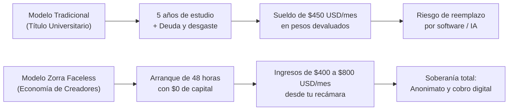
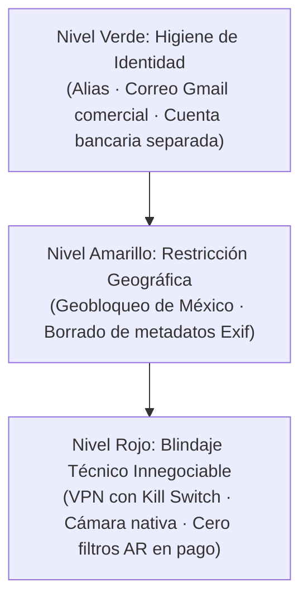

# BLOQUE 1 (PÁGS. 1 A 5): MANIFIESTO, SOBERANÍA DIGITAL Y OPSEC MILITAR

---

## PÁGINA 1 — PORTADA Y MANIFIESTO DE SOBERANÍA FINANCIERA DIGITAL

```
================================================================================
                                ZORRA FACELESS
          El Playbook Oficial de Monetización en Dólares Sin Rostro
     Volumen 1: De $0 Inversión a $800 USD/Mes con Cosplay Kemonomimi y Redes
================================================================================
```

### El Manifiesto: Tu Habitación es una Micro-Empresa Global en Dólares

> *"El error del siglo XXI no es ganar dinero con internet; el error es seguir vendiendo 45 horas semanales de tu vida a cambio de un salario devaluado en una oficina que la Inteligencia Artificial reemplazará en menos de tres años."*

Bienvenida a tu propio territorio. Si tienes este manual en tus manos, probablemente estás cansada de escuchar promesas vacías sobre el mercado laboral tradicional o de sentir la angustia de que el dinero en pesos no rinde frente al aumento implacable del costo de vida.

Este libro no es un panfleto motivacional. Es un **dossier de operaciones financieras y marketing de guerrilla digital** diseñado para mujeres que han decidido no pedir permiso para construir su independencia económica.

Aquí aprenderás a transformar tu teléfono celular, tu conexión a internet y un arquetipo visual altamente codiciado —el cosplay anónimo con orejas y cola de zorro (*kemonomimi / kitsune*)— en una máquina de generación de ingresos pasivos y recurrentes en dólares estadounidenses ($USD), sin mostrar jamás tu rostro, sin salir de tu recámara y sin arriesgar tu privacidad ante familiares, amigos o futuros empleadores.

#### Las 3 Leyes Fundamentales de Este Playbook:
1. **La Soberanía es Financiera o No Es Nada:** No existe libertad personal ni autonomía sin control total de tus propios ingresos.
2. **El Rostro es un Producto Escaso, No una Obligación:** En la economía de la atención masculina global, el misterio y la fantasía proyectada convierten hasta tres veces más que la sobreexposición visual vulgar.
3. **Arbitraje Geográfico Infalible:** Cobramos en la moneda más fuerte del planeta (**Dólares $USD**) y gastamos en el costo de vida local (**Pesos $MXN**).

---

## PÁGINA 2 — LA TRAMPA DEL TÍTULO UNIVERSITARIO Y LA AUTOMATIZACIÓN POR IA

### El Colapso del Modelo Tradicional
Durante décadas, a las mujeres jóvenes en México y Latinoamérica se les vendió una fórmula lineal: *«Estudia 5 años de universidad, titúlate, consigue un empleo corporativo y tendrás una vida resuelta»*.

En 2026, los datos económicos demuestran que esa promesa está rota:
- **La Realidad Salarial:** El salario promedio de una profesionista recién egresada en México oscila entre los **$8,000 y $12,000 MXN mensuales** ($400 a $600 USD). A cambio, se exigen jornadas de 9 a 10 horas diarias, más de 2 horas de transporte público peligroso y desgastante, y ambientes laborales saturados de favoritismos o acoso.
- **La Pérdida del Retorno de Inversión (ROI):** Una carrera universitaria promedio representa una inversión de más de $150,000 MXN (entre inscripciones, materiales y transporte). Recuperar ese capital con los sueldos actuales toma más de 6 a 8 años de sumisión laboral.

### El Impacto Inminente de la Inteligencia Artificial (Dato Duro)
Los reportes de investigación laboral más prestigiosos a nivel global —incluyendo el informe *Future of Jobs* del **Foro Económico Mundial (WEF)** y análisis de **Goldman Sachs**— coinciden en una conclusión demoledora:

> **Más del 45% de los puestos administrativos, de servicio al cliente, recepcionistas, redacción de informes y soporte operativo —desempeñados históricamente en un 68% por mujeres jóvenes— están en proceso acelerado de automatización antes del año 2030.**



Quien insista en competir contra un modelo de lenguaje o un software administrativo dentro de una oficina corporativa está librando una batalla perdida. Quien aprenda a capitalizar la **atención, la psicología del deseo y el coleccionismo digital**, se vuelve financieramente intocable.

---

## PÁGINA 3 — EL FIN DEL DINERO FÍSICO Y EL ARBITRAJE EN DÓLARES

### La Digitalización Total de la Economía
El dinero en efectivo físico está en proceso de retirada global. Bancos centrales, billeteras virtuales y pasarelas de pago transfronterizas han transformado el dinero en bytes. En esta nueva economía, estar atada exclusivamente a una nómina en efectivo o en pesos mexicanos equivale a depender de una economía local inflacionaria.

### La Ecuación del Arbitraje Cambiario
La mayor ventaja de una creadora digital independiente en Latinoamérica es el **arbitraje cambiario**:

$$\text{Poder Adquisitivo} = \frac{\text{Ingresos en Dólares (EE.UU. / Europa)}}{\text{Costo de Vida en Moneda Local (México / LATAM)}}$$

| Situación Laboral | Esfuerzo / Tiempo | Ingreso Bruto | Equivalente en Moneda Local | Poder Real de Compra |
|---|---|---|---|---|
| **Empleada de Mostrador / Oficina (MX)** | 160 horas al mes | $9,000 MXN | ~$450 USD | Apenas cubre renta y pasajes |
| **Sesión de Drip Sexting Faceless (15 min)** | 15 minutos en cama | $41 USD | ~$800 MXN | Cubre la despensa semanal básica |
| **Venta Pasiva de 1 Pack de Cosplay (ManyVids)** | 0 horas (ya grabado) | $15 USD | ~$292 MXN | Un almuerzo completo ganado mientras duermes |
| **Meta Mensual de Creadora Faceless (Mes 2)** | 15 horas a la semana | **$600 USD** | **~$11,700 MXN** | Supera el sueldo promedio nacional |

Un comprador masculino en Texas, California o Londres paga **$20 USD** por un video o un conjunto de fotos exclusivas con la misma ligereza con la que compra un café en Starbucks. Para él son números insignificantes; para ti representan casi un día completo de salario mínimo mexicano depositado de inmediato en tu cuenta.

---

## PÁGINA 4 — PROTOCOLO OPSEC DE GRADO MILITAR (CERO FILTRACIONES)

El mayor temor de cualquier mujer inteligente al iniciar en el ecosistema digital es la exposición: *¿Qué pasa si mi familia, mi pareja o mis compañeros de estudio me descubren?*

La respuesta es simple: **Si sigues este protocolo técnico de seguridad operativa (OpSec), es matemáticamente imposible que te identifiquen.**

### La Matriz de Seguridad en 3 Niveles:



| Nivel de Riesgo | Punto de Auditoría | Herramienta / Acción Obligatoria | Estado de Cumplimiento |
|---|---|---|:---:|
| 🟢 **Bajo** | **Identidad Separada** | Crear una cuenta de Gmail dedicada exclusivamente al personaje, sin iniciales reales ni fechas de nacimiento. | `[ OBLIGATORIO ]` |
| 🟢 **Bajo** | **Alias de Personaje** | Usar un seudónimo artístico comercial (ej. *KitsuneValeria, FoxMaeve*). Jamás revelar tu ciudad natal ni colonia. | `[ OBLIGATORIO ]` |
| 🟡 **Medio** | **Geobloqueo Territorial** | Configurar en Fansly, Stripchat y ManyVids el bloqueo total de México y tu estado natal. Nadie navegando desde tu país podrá ver tu perfil. | `[ OBLIGATORIO ]` |
| 🟡 **Medio** | **Limpieza de Metadatos Exif** | Pasar cada foto o video por la app **Metapho** (iOS) o **Photo Exif Editor** (Android) antes de subirlo a X o Telegram. Esto elimina las coordenadas GPS exactas de tu casa. | `[ OBLIGATORIO ]` |
| 🔴 **Crítico** | **VPN con Kill Switch Activo** | Utilizar **Mullvad VPN** o **ProtonVPN** en tu celular y computadora. El *Kill Switch* corta el internet si la VPN se desconecta, evitando fugas de IP real. | `[ INNEGOCIABLE ]` |
| 🔴 **Crítico** | **Cero Filtros AR en Contenido de Pago** | **Regla de Oro:** Jamás grabes contenido exclusivo usando filtros de realidad aumentada dentro de TikTok o Instagram. Si la app sufre lag, expondrá tu rostro. Graba en cámara nativa y edita fuera. | `[ INNEGOCIABLE ]` |

---

## PÁGINA 5 — LA PSICOLOGÍA DEL PERSONAJE KITSUNE (EL PODER DE LA MÁSCARA)

### ¿Por Qué el Misterio Vende Más que la Sobreexposición?
En el mercado digital saturado, las modelos que muestran su rostro y se desnudan por completo sufren de una rápida depreciación: una vez que el usuario vio su cara y su cuerpo, la curiosidad se extingue en segundos y el tipper pasa a la siguiente sala.

El arquetipo de la **Zorra de Cosplay (*Kitsune / Kemonomimi*)** opera bajo principios psicológicos opuestos:

1. **El Efecto de Pantalla en Blanco (Proyección Fantasiosa):**  
   Al mantener tu rostro oculto detrás de un antifaz de encaje, una máscara estilizada o un encuadre clavícula-abajo, el cerebro del comprador proyecta en ti los rasgos de su waifu favorita, su actriz predilecta o su ideal platónico. Te conviertes en la encarnación de su fantasía personal sin ningún esfuerzo extra de tu parte.
2. **Inmersión Total de Personaje (*Character Lock*):**  
   En la mitología oriental, el espíritu del zorro es legendariamente astuto, travieso, elegante y caprichoso. No eres una persona común buscando propinas; eres un ser mítico que concede el privilegio de interactuar con ella.
3. **La Escalera de Identidad en 3 Capas:**
   - *Capa Pública (Redes Abiertas):* Máscara/antifaz completo + orejas + colita visible.
   - *Capa VIP (Telegram / Fansly):* Encuadres cercanos a labios y mentón, clavícula, espalda y movimiento cinético.
   - *Capa Secreta:* El misterio jamás se revela en su totalidad. **El rostro no es un requisito que debas disculpar; es el tesoro definitivo que mantiene viva la retención de los grandes donadores (Whales).**

> **📌 Regla de Oro del Personaje:**  
> Nunca pidas dinero desde la necesidad. El zorro no mendiga: el zorro seduce, juega, desaparece y hace que sean ellos quienes paguen por el derecho a entrar a su madriguera.

