# BLOQUE 6 (PÁGS. 26 A 30): CAZA Y RETENCIÓN DE WHALES Y EL SISTEMA SEMANAL DE 15 HORAS

---

## PÁGINA 26 — LA LEY DEL 80/20 EN EL ECOSISTEMA DIGITAL: QUÉ ES UNA "WHALE"

En las mentorías privadas de agencias internacionales que cobran hasta $1,500 USD por acceso, se enseña una verdad financiera que cambia por completo la manera de trabajar: **no necesitas convencer a mil hombres de que te den un dólar; solo necesitas encontrar y retener a 5 "Whales" (Ballenas) que gasten de $150 a $500+ USD al mes contigo.**

### El Perfil Psicológico de una Ballena en Estados Unidos
Una *Whale* no es un jovencito universitario buscando fotos gratis. Es un hombre de entre 30 y 55 años en Estados Unidos, Canadá o Reino Unido (ingeniero, programador, financiero o empresario) con ingresos altos, largas jornadas de trabajo y profunda soledad emocional.
- **Lo que busca:** No paga por sexo explícito (que tiene gratis en internet); paga por **atención exclusiva, complicidad dentro de la fantasía del personaje y la sensación de ser el patrocinador consentido de su zorrita secreta**.

### Cómo Detectar a una Ballena en los Primeros 2 Minutos de Chat:

| Señal Observada | 🐋 Es una Ballena ($200–$1,000+ USD/mes) | 🐟 Es un Comprador Único ($8–$15 USD) |
|---|---|---|
| **Actitud ante el peaje de $10 USD** | Lo paga sin chistar y pregunta de inmediato cuánto cuesta un video largo o personalizado. | Regatea, pide muestras gratis (*"free preview?"*) o se queja del filtro. |
| **Forma de comunicarse** | Escribe oraciones completas, es respetuoso con las reglas del personaje y responde rápido. | Solo manda palabras sueltas (*"hot", "more"*) o emojis sin conversación. |
| **Conexión recurrente** | Menciona su trabajo, sus horarios o te avisa cuándo es su día de pago (*payday*). | Compra una sola vez de madrugada y jamás vuelve a escribir. |

---

## PÁGINA 27 — EL "CRM DE BALLENAS" Y LOS 3 MENSAJES DE QUINCENA GRINGA

Las creadoras que superan los $800 USD mensuales no confían en su memoria: llevan un registro privado en las notas de su celular llamado **CRM de Ballenas**.

### Los 7 Datos que Debes Anotar de Cada Gran Comprador:
1. **Nombre o apodo preferido:** Cómo le gusta que lo llames susurrando.
2. **Zona horaria:** (Ej. *EST Nueva York / CST Texas / PST California*).
3. **Disparador sensorial favorito:** (*Cola en movimiento, orejas, pies con calcetas, voz ASMR o ser ignorado*).
4. **Día de pago (*Payday*):** Qué viernes del mes recibe su nómina.
5. **Monto total invertido en ti hasta la fecha.**
6. **Detalle personal de conversación:** (Ej. *"Trabaja en sistemas de noche, tiene un gato negro"*).
7. **Último contenido que compró** (para nunca venderle dos veces el mismo archivo).

---

### Los 3 Mensajes VIP de Reactivación para Viernes de Quincena (Copy-Paste)
Todos los viernes entre las **17:00 y las 19:30 hrs (hora CDMX)**, cuando los bancos en EE.UU. acaban de liberar los cheques semanales, envía uno de estos mensajes a los mejores clientes de tu lista:

#### 1. El Gancho del Aburrimiento (Venta de $30 USD)
> **Cópialo en inglés:**  
> `Hey. It’s Friday. The tail is out and I’m bored. You usually like the longer ones around now. Want the 2-min version with your name?`  
> *(Traducción: Hola. Es viernes. La cola está afuera y estoy aburrida. A ti normalmente te gustan los largos por estas fechas. ¿Quieres la versión de 2 minutos con tu nombre?)*

#### 2. Exclusividad para Pagadores ($30 USD)
> **Cópialo en inglés:**  
> `Payday reminder from the fox. I saved the new bed clip for the ones who actually pay. It’s $30 today only if you want it. No pressure. She just remembers who spends.`  
> *(Traducción: Recordatorio de quincena de la zorra. Guardé el clip nuevo de la cama para los que sí pagan. Son $30 solo hoy si lo quieres. Sin presión. Ella recuerda quién gasta).*

#### 3. Reactivación con Nota de Voz ($25 USD)
> **Cópialo en inglés:**  
> `You went quiet after the last voice note. I’m recording a short one right now with the ears on. Your name is already in it if you want it for $25. Reply “YES” and I’ll send the payment link.`  
> *(Traducción: Te quedaste callado después de la última nota de voz. Estoy grabando una corta ahora con las orejas puestas. Tu nombre ya está en ella por $25. Responde "YES" y te mando el link).*

---

## PÁGINA 28 — LA MATEMÁTICA REAL DE LA DIVERSIFICACIÓN ($400 A $815 USD/MES)

No dependas de una sola fuente de ingresos. Cuando combinas transmisiones breves, mensajes por goteo, tienda pasiva en ManyVids y tu lista de Throne, las pequeñas ventas en dólares se acumulan formando un sueldo superior al de cualquier oficina en México:

### Tablero Financiero Mensual (Escenario Realista — Mes 1 a 2)

| Fuente de Ingreso | Precio Unitario Promedio | Volumen Mensual Mínimo | Ingreso Bruto (USD) | Equivalente en Pesos (TC $19.50) |
|---|---|---|---|---|
| **1. Streaming Anónimo** (Stripchat / Fansly) | $25 USD por noche (90 min) | 12 transmisiones al mes (3/sem) | **$300 USD** | ~$5,850 MXN |
| **2. Drip Sexting en DMs** (Telegram / Fansly)| $35 USD por sesión de goteo | 5 sesiones al mes (1.2/sem) | **$175 USD** | ~$3,412 MXN |
| **3. Packs "Paws & Tails"** (ManyVids) | $15 USD por descarga | 8 ventas pasivas al mes | **$120 USD** | ~$2,340 MXN |
| **4. Audios ASMR + Tributos $10** | $15 USD promedio | 6 encargos / entradas al mes | **$90 USD** | ~$1,755 MXN |
| **5. Regalos / Efectivo en Throne** | $25 USD por regalo | 3 regalos al mes | **$75 USD** | ~$1,462 MXN |
| **6. Artículos Físicos con Perfume** | $55 USD por envío | 1 venta al mes | **$55 USD** | ~$1,072 MXN |
| **TOTAL MENSUAL CONSOLIDADO** | — | — | **$815 USD / mes** | **~$15,892 MXN / mes** |

> **💡 Escenario Mínimo al 50% de Ritmo:**  
> Incluso operando a la mitad de este volumen mientras estudias o tienes otro empleo, generas **$407 USD (~$7,940 MXN) libres cada mes** desde tu cama, dedicando apenas 2 horas diarias.

---

## PÁGINA 29 — EL SISTEMA SEMANAL DE 15 HORAS (LA TÉCNICA DEL "BATCHING")

El error que quema y agota a las novatas es tardar tres horas todos los días vistiéndose, acomodando luces y pensando qué grabar para subir un solo video.

Las profesionales operan bajo el método industrial de **Producción en Lote (*Batching*)**: te pones el traje de zorrita **una sola tarde a la semana (el lunes)**, grabas todo el material de los siguientes 7 días en 90 minutos y dedicas el resto de la semana exclusivamente a publicar y cobrar desde tu celular.

```mermaid
gantt
    title Cronograma Semanal de 15 Horas · Sistema Batching
    dateFormat  HH:mm
    axisFormat  %H:%M

    section LUNES (2.5 hrs)
    Ponerse outfit + Grabar 12 clips de 7s y 15 fotos :done, l1, 16:00, 90m
    Edición rápida en CapCut (textos + tracking)      :active, l2, 17:30, 60m

    section MARTES (2.5 hrs)
    Publicar en X/Reels + DMs de goteo                :m1, 19:00, 60m
    Transmisión en Vivo Anónima (Hora pico EE.UU.)    :m2, 20:30, 90m

    section MIÉRCOLES (1.5 hrs)
    Cero Cámara · Subir clips + Ventas por Chat VIP   :x1, 20:00, 90m

    section JUEVES (2.5 hrs)
    Publicar cortos + Seguimiento de Throne           :j1, 19:00, 60m
    Segunda Transmisión en Vivo                       :j2, 20:30, 90m

    section VIERNES (3.0 hrs)
    Mensajes VIP de Quincena Gringa (Payday)          :v1, 18:00, 60m
    Transmisión Estelar de Viernes + Privados         :v2, 20:00, 120m

    section SÁBADO (1.5 hrs)
    Subir pack a ManyVids + Audios ASMR en cama       :s1, 18:00, 90m

    section DOMINGO (1.5 hrs)
    Análisis de métricas + Retiro de dólares a banco  :d1, 12:00, 90m
```

---

## PÁGINA 30 — REGLA DE PRIORIDAD DEL TIEMPO Y PREVENCIÓN DEL AGOTAMIENTO

Habrá días en que tengas exámenes, compromisos familiares o simplemente cansancio y solo dispongas de **45 minutos libres**. En esos días, aplica de forma innegociable la **Jerarquía de Conversión Financiera**:

$$\text{Mensajes VIP Pagados (8\%–10\% conv.)} > \text{Live Stream (3\% conv.)} > \text{Edición de Redes (0.04\% conv.)}$$

### Los 6 Errores Mortales que Destruyen un Negocio Faceless:
1. **Sacrificar un chat de pago por editar un TikTok:** Nunca dejes esperando a una Ballena con tarjeta en mano en Telegram o Fansly por estar buscando un audio en tendencia.
2. **Poner enlaces directos en la descripción de TikTok o en el primer tuit de X:** Mata el alcance orgánico al instante. El enlace siempre va en la biografía o en el segundo tuit.
3. **Subir videos con el logo o marca de agua de otra app:** Instagram Reels reduce un 40% las vistas si detecta la marca de agua de TikTok. Exporta siempre limpio desde CapCut.
4. **Fijar tus precios en pesos mexicanos:** Tu mercado es internacional; todo se cotiza y se cobra en **Dólares ($USD)**.
5. **Romper el peaje de $10 USD "solo por esta vez":** Si respondes gratis a un usuario que no pagó el tributo de entrada, destruyes la autoridad de tu personaje.
6. **Publicar 10 videos el lunes y desaparecer 5 días:** Los algoritmos premian la constancia diaria de 2 clips cortos por encima de los atracones esporádicos.

