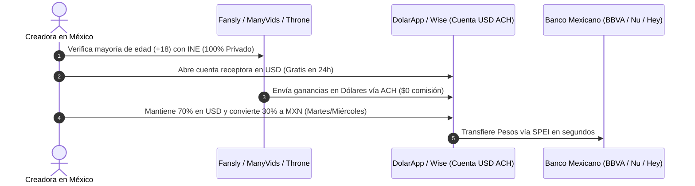

# BLOQUE 7 (PÁGS. 31 A 35): COBRO LIMPIO EN MÉXICO, BLINDAJE FISCAL Y PLAN DE 7 DÍAS

---

## PÁGINA 31 — DE TU PRIMER DÓLAR A TU BANCO MEXICANO (DOLARAPP, WISE Y SPEI)

Ganar en dólares no sirve de nada si pierdes el 10% en comisiones bancarias abusivas o si bloquean tu cuenta por no saber cómo retirar. Esta es la ruta financiera limpia, rápida y casi gratuita para traer tus dólares a México:



### Comparativa Real de Retiro sobre $500 USD Ganados:

| Método de Cobro | Comisión de Recepción | Tipo de Cambio | Pesos Netos en tu Mano (TC $19.50) | Veredicto |
|---|---|:---:|:---:|---|
| **Wise (Cuenta USD)** | $0 USD (vía ACH) | Excelente | **~$9,701 MXN** | ⭐⭐⭐⭐⭐ Óptimo |
| **DolarApp (App México)** | $0 USD (vía ACH) | Excelente | **~$9,681 MXN** | ⭐⭐⭐⭐⭐ El más rápido por SPEI |
| **USDT (Polygon) → Bitso**| <$0.05 USD | Muy bueno | **~$9,603 MXN** | ⭐⭐⭐⭐ Ideal si usas cripto |
| **Paxum** | $1 a $3 USD | Regular | **~$9,457 MXN** | ⭐⭐⭐ Útil para Stripchat |
| **Transferencia Bancaria Directa** | $20 a $35 USD | Pésimo | **~$9,280 MXN** | ❌ **Evitar (Pierdes >$400 MXN)** |

### La Regla de las 3 Cuentas (Separación Estricta):
1. **Cuenta A (Receptora en Dólares):** Tu cuenta en *DolarApp* o *Wise*. Aquí llegan los pagos de las plataformas y aquí guardas tu ahorro en dólares protegido contra la devaluación.
2. **Cuenta B (Operativa en Pesos):** Una cuenta digital mexicana (*Nu, Hey Banco o BBVA*). Recibe las conversiones por SPEI para pagar tu internet, luz y equipo.
3. **Cuenta C (Tu Nómina Personal):** Tu tarjeta personal de siempre, a la que te transfieres un "sueldo fijo" cada quincena.

---

## PÁGINA 32 — BLINDAJE FISCAL ANTE EL SAT: PAGA SOLO EL 1% EN RESICO Y 0% DE IVA

Uno de los secretos mejor guardados de la legislación tributaria mexicana es que **exportar contenido y servicios digitales al extranjero tiene el trato fiscal más barato del país**. No necesitas esconder tu dinero bajo el colchón; puedes bancarizarlo al 100% pagando menos del 1.5% de impuestos.

### 1. Tu Régimen Ideal: RESICO (Régimen Simplificado de Confianza)
A diferencia del Régimen de Plataformas Tecnológicas (que aplica a choferes de Uber o anfitriones de Airbnb en México y retiene impuestos altos), tú cobras de empresas extranjeras sin establecimiento en México. Por ley, puedes tributar en **RESICO** hasta por $3.5 millones de pesos anuales:

| Ingreso Mensual en Dólares | Equivalente Mensual (MXN) | Tasa de ISR en RESICO | Impuesto Mensual a Pagar al SAT |
|:---:|:---:|:---:|:---:|
| **$300 USD** | ~$5,850 MXN | **1.0%** | **$58.50 MXN al mes** |
| **$500 USD** | ~$9,750 MXN | **1.0%** | **$97.50 MXN al mes** |
| **$1,000 USD** | ~$19,500 MXN | **1.0%** | **$195.00 MXN al mes** |
| **$2,500 USD** | ~$48,750 MXN | **1.1%** | **$536.25 MXN al mes** |

### 2. ¿Por Qué Pagas 0% de IVA?
De acuerdo con el **Artículo 29 de la Ley del IVA (LIVA)**, la prestación de servicios digitales que son aprovechados por residentes en el extranjero (tus compradores de EE.UU., Canadá y Europa) se considera **Exportación de Servicios** y está gravada a la **Tasa del 0% de IVA**. No tienes que desembolsar el 16% de IVA.

> ⚠️ **Nota Contable:** Antes del día 17 de cada mes, suma los depósitos recibidos en tu cuenta multiplicados por el tipo de cambio del Diario Oficial de la Federación (DOF) y presenta tu declaración mensual en [sat.gob.mx](https://sat.gob.mx/). Con menos de $100 pesos de impuesto por cada $500 USD ganados, tu dinero queda 100% legalizado para comprar un auto, rentar un departamento o invertir.

---

## PÁGINA 33 — HOJA DE CONTROL FINANCIERO Y DASHBOARD SEMANAL (PLANTILLA)

Lo que no se mide, no se puede escalar. Copia esta estructura en una hoja de cálculo de Google Sheets o llévala impresa en tu carpeta de trabajo para auditar qué canal te está dando más dólares por cada minuto invertido:

### 1. Registro Diario de Operaciones

| Fecha | Canal de Venta | Producto / Acción Vendida | Importe (USD) | Equiv. MXN (TC DOF) | Minutos Invertidos | Rentabilidad ($USD / Hora) | ¿Supera los $8/hr? |
|---|---|---|:---:|:---:|:---:|:---:|:---:|
| *Viernes* | *Throne* | *Peaje de entrada DM* | *$10.00* | *$195.00* | *2 min* | *$300.00/hr* | ✅ |
| *Viernes* | *Telegram VIP* | *Secuencia Drip Sexting* | *$53.00* | *$1,033.50* | *15 min* | *$212.00/hr* | ✅ |
| *Sábado* | *ManyVids* | *Pack Paws & Tails (Pasivo)*| *$14.99* | *$292.30* | *0 min* | *Pasivo* | ✅ |
| `____/____` | `____________` | `_______________________` | `$______` | `$________` | `____ min` | `$______/hr` | `[ ]` |
| `____/____` | `____________` | `_______________________` | `$______` | `$________` | `____ min` | `$______/hr` | `[ ]` |
| `____/____` | `____________` | `_______________________` | `$______` | `$________` | `____ min` | `$______/hr` | `[ ]` |
| **TOTAL** | — | — | **$_______** | **$_________** | **_____ min** | **$_______/hr** | — |

---

### 2. Tablero Semanal de Metas (KPIs de la Zorra Faceless)

| Indicador Clave (KPI) | Meta Mínima (Arranque) | Meta Óptima (Mes 2–3) | Mi Resultado de la Semana |
|---|:---:|:---:|:---:|
| **Clips de 7s publicados (TikTok/Reels/X)** | 12 clips | 18 clips | `________` |
| **Nuevos tributos de entrada ($10 USD)** | 2 tributos | 6 tributos | `________` |
| **Sesiones de Drip Sexting cerradas** | 1 sesión | 4 sesiones | `________` |
| **Horas totales trabajadas en la semana** | 15 horas | 15 horas | `________` |
| **Ingreso Bruto Semanal en Dólares** | **$100 USD** | **$250+ USD** | **`$_______ USD`** |

---

## PÁGINA 34 — EL CALENDARIO DE DESPEGUE DE 7 DÍAS (ACCIÓN INMEDIATA)

Aquí termina la teoría y comienza la ejecución. Una vez que grabaste tus primeros clips el lunes siguiendo el Bloque 2, ejecuta al pie de la letra este **Calendario de Lanzamiento de 7 Días** en horario de la Ciudad de México (CDMX):

| Día de Lanzamiento | Hora Exacta (CDMX) | Hook en Inglés a Publicar (Tuit 1) | Pieza Visual (Media) | Segundo Tuit (30 seg después) y Acción en Historias |
|---|:---:|---|---|---|
| **DÍA 1 (Jueves)** | **20:30 hrs** | `Nobody was supposed to see the tail move like that.` | Foto de espaldas en recámara, cola esponjosa visible y antifaz puesto. | **Tuit 2:** `Full thing is in the link. She only does it when she feels like being mean. $10 tribute first.`<br>**Historias:** Clip de 5s + *"New fox just landed"*. |
| **DÍA 2 (Viernes de Quincena)**| **21:00 hrs** | `She only shows the collar and the tail in public. The rest is locked.` | Primer plano de clavícula con gargantilla (*choker*) y orejas. | **Tuit 2:** `Tribute $10 on Throne and she opens DMs.`<br>**Historias:** Encuesta interactiva *"Tail or ears first?"*. |
| **DÍA 3 (Sábado)** | **19:00 hrs** | `The fluffy tail is real. The girl under it is worse.` | Video en bucle de 7s moviendo la cola sobre la cama. | **Tuit 2:** `Full clip behind the link. She bites if you skip the tribute.`<br>**Acción:** Subir primer pack de pies y cola a ManyVids ($14.99). |
| **DÍA 4 (Domingo)** | **18:30 hrs** | `The tail is the only thing you get for free. Everything else costs.` | Foto encuadre clavícula-abajo frente al espejo con flash. | **Tuit 2:** `Throne link in bio. Send “TAIL” after you pay.`<br>**Historias:** Cuenta regresiva *"Last free tail of the week"*. |
| **DÍA 5 (Lunes)** | **20:00 hrs** | `I recorded this on my bed after I got home. The tail kept getting in the way.` | Video de 10s en cama con calcetas musleras. | **Tuit 2:** `The uncensored version is behind the link. Don’t make her wait.`<br>**Acción:** Tarde de *Batching* para grabar la semana 2. |
| **DÍA 6 (Martes)** | **21:30 hrs** | `Collarbone down. Ears up. Tail out. That’s the rule.` | Foto estética cumpliendo la regla de encuadre fijo. | **Tuit 2:** `The full version is in the link. Tribute first.`<br>**Acción:** Primera transmisión en vivo de 90 min con etiqueta *New*. |
| **DÍA 7 (Miércoles)**| **20:00 hrs** | `The ears stay on. The mask stays on. Everything else comes off when you pay.` | Set de 2 fotos (1 de antifaz/orejas + 1 de silueta con cola). | **Tuit 2:** `Link in bio. $10 tribute first or she ignores you.`<br>**Acción:** Cierre de semana y primer retiro de dólares a DolarApp. |

---

## PÁGINA 35 — CONTRAPORTADA Y MANIFIESTO FINAL: BIENVENIDA A TU SOBERANÍA

Has llegado a la última página de este manual. Ahora posees información táctica, matemática, psicológica y fiscal que el 99% de las personas allá afuera desconoce por completo.

Mientras el mundo exterior sigue discutiendo por sueldos estancados en oficinas grises y temiendo el avance de la automatización, tú tienes en tus manos un **sistema probado paso a paso** para generar ingresos en la moneda más fuerte del mundo desde la seguridad y el anonimato absoluto de tu habitación.

### Las 3 Reglas para Llevar Contigo Siempre:
1. **Protege tu anonimato como tu activo más valioso:** Tu VPN, tu geobloqueo y tu encuadre clavícula-abajo son tu escudo inquebrantable.
2. **Nunca bajes tus precios ni regales tu atención:** Quien quiere entrar a la madriguera de la zorrita, paga el peaje en dólares por adelantado.
3. **Convierte tus ganancias en patrimonio real:** Usa tus dólares para pagar tus deudas, financiar tus estudios, ahorrar en moneda fuerte y construir tu libertad.

```
================================================================================
                          EL FUTURO ES DIGITAL.
                 LA MÁSCARA ES TU ESCUDO. EL DÓLAR ES TU LIBERTAD.
             
                        — PLAYBOOK ZORRA FACELESS —
                      Edición Oficial · México & LATAM
================================================================================
```

