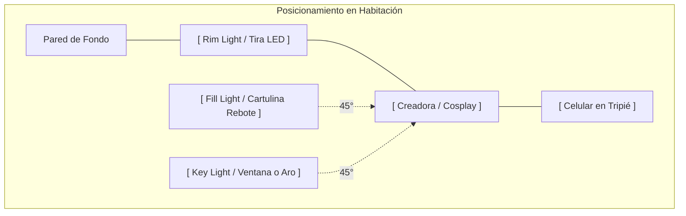
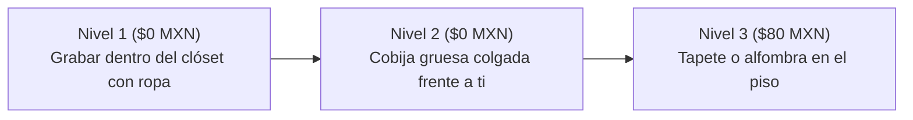
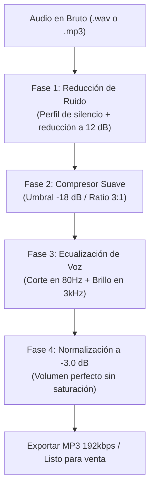

# 03 · Setup de Producción Casera: Iluminación, Acústica y Audio
> Guía técnica de $0 a $500 MXN para creadores de contenido que graban en recámara  
> Para creadores digitales independientes que buscan calidad profesional con recursos mínimos.  
> Versión 1.0 · Noviembre 2026 · Generado con Claude Sonnet 4.6

---

## BLOQUE 1 — ESQUEMA DE ILUMINACIÓN DE TRES PUNTOS

La iluminación de tres puntos es el estándar de la industria audiovisual desde los inicios del cine y la televisión. Con recursos cotidianos en tu habitación puedes replicarla al 100% sin gastar en reflectores profesionales.

### Las tres luces y su función:

| Luz | Función Principal | Recurso Casero ($0 MXN) | Recurso de Bajo Costo |
|---|---|---|---|
| **Key Light (Luz principal)** | Ilumina el sujeto directamente; define volumen y forma. | Ventana de día con luz indirecta o lámpara de mesa. | Aro de luz LED 10" con tripié ($250–$350 MXN). |
| **Fill Light (Luz de relleno)** | Suaviza las sombras duras que crea la luz principal. | Pared blanca cercana o pliego de cartulina blanca ($15 MXN). | Segunda lámpara difuminada. |
| **Rim / Back Light (Luz de recorte)**| Separa al sujeto del fondo; crea dimensión y profundidad. | Lámpara de escritorio colocada detrás y arriba. | Tira LED RGB económica ($80–$120 MXN). |

---

### Key Light — Cómo usarla con recursos caseros

#### Opción A: Ventana de día (Costo $0)
- Colócate de frente o a 45° respecto a la ventana, **nunca de espaldas a ella** (a contraluz directo la cámara del celular se ciega).
- Evita el sol directo que quema la piel con sombras duras: busca luz indirecta (cielo nublado o sol matutino).
- Si la luz entra muy fuerte, cuelga una sábana blanca delgada o cortina traslúcida frente a la ventana: actúa como una caja difusora suave (*softbox*) que suaviza la textura de la piel.
- **Mejor horario:** 1 a 2 horas después del amanecer o 2 horas antes del atardecer para obtener una luz dorada y cinematográfica.

#### Opción B: Lámpara de escritorio difuminada ($0–$80 MXN)
- Coloca la lámpara a la altura de tu rostro o ligeramente arriba, a 45° lateral.
- Envuelve la pantalla de la lámpara con una hoja de **papel vegetal (papel mantequilla para hornear)** sujeta con pinzas de ropa. Esto difumina la bombilla eliminando los puntos ciegos de luz dura.  
  *(Asegúrate de usar focos LED fríos, nunca bombillas incandescentes calientes).*
- Distancia recomendada: 60 a 90 cm de ti.

---

### Fill Light — Cómo rellenar sombras sin comprar otra lámpara

El *Fill Light* no necesita ser otra fuente de energía eléctrica: funciona como un **reflector pasivo**:
- **Rebote en pared blanca:** Si colocas tu silla a 1 metro de una pared blanca en el lado opuesto a la ventana, la pared rebotará la luz natural hacia tu perfil en sombra.
- **Pliego de cartulina blanca ($15 MXN):** Apoya una cartulina blanca grande sobre una silla frente a ti inclinada a 45°. Aclara las ojeras y sombras bajo la barbilla instantáneamente.
- **Regla de proporción:** La luz de relleno debe ser entre un 30% y un 50% de la intensidad de la luz principal. Si es demasiado fuerte, la imagen pierde contraste y se ve plana.

---

### Rim / Back Light — La luz de recorte que separa tu silueta

Es la luz que mayor impacto visual genera con la menor inversión:
- **Tira LED económica ($80–$120 MXN en Mercado Libre o tiendas locales):**
  - Colócala detrás de ti, en el borde de un mueble, cabecera de la cama o zoclo de la pared.
  - Colores recomendados: Blanco cálido (3000K) para un tono íntimo y lujoso, o azul/morado tenue para estética cyberpunk o anime.
- **Efecto de halo:** Al incidir desde atrás, la luz perfila los hombros, el cuello y resalta de manera espectacular la textura de las orejas y el pelaje de la cola de zorro, separándote completamente de la pared del fondo.

---

### Solución a Problemas Frecuentes de Iluminación:

| Problema Visual | Causa Técnica | Solución Rápida |
|---|---|---|
| **Sombras oscuras bajo nariz y ojos** | La luz principal está muy arriba en el techo. | Bajar la fuente de luz al nivel de los ojos o colocar cartulina de rebote abajo. |
| **Fondo completamente negro / deprimente** | Ausencia de luz de recorte y profundidad. | Encender una luz tenue detrás o una tira LED contra la pared. |
| **Imagen plana sin dimensión** | Luz directa frontal demasiado potente. | Mover la luz principal a 45 grados hacia un lado. |
| **Tono de piel amarillento o verdoso** | Mezcla de foco incandescente con luz de ventana. | Apagar focos de techo y usar una sola temperatura de color (luz blanca/neutra). |

---

## BLOQUE 2 — TRATAMIENTO ACÚSTICO CASERO (CERO ECO EN RECÁMARA)

El eco de habitación vacía ("sonido de baño") arruina cualquier video o nota de voz, aunque tengas el teléfono más moderno. El oído humano asocia el eco con falta de profesionalismo.

### Por qué ocurre la reverberación:
El sonido de tu voz rebota en superficies duras: pisos de loseta o cemento, cristales de ventanas y paredes lisas sin cuadros.

### Soluciones Caseras en 3 Niveles ($0 a $150 MXN):

1. **La Cabina de Clóset (Resultado de Estudio Profesional a $0 MXN):**  
   - Abre las puertas de tu clóset lleno de ropa colgada. Coloca tu teléfono o micrófono en medio de las prendas y graba mirando hacia adentro de la ropa.  
   - Las telas, abrigos y camisetas absorben el 80% de las frecuencias medias y agudas de la voz. Es la técnica secreta que usan actores de doblaje cuando viajan en hoteles.
2. **Cobija pesada en la pared opuesta:**  
   - Cuelga una cobija gruesa o cobertor en la pared que tienes de frente mientras hablas. Esto corta el rebote frontal del sonido antes de que regrese al micrófono.
3. **Alfombra o toallas en el suelo:**  
   - Si tu habitación tiene piso de mosaico cerámico, coloca un tapete o dos toallas de baño gruesas justo debajo de tu silla. Elimina el rebote vertical.

> **Prueba del Aplauso en 5 Segundos:** Da una palmada seca y fuerte en tu cuarto. Si escuchas un "clac" seco y limpio, tu acústica es perfecta. Si escuchas un zumbido metálico o eco ("clac-ac-ac"), añade más cojines o cobijas.

---

## BLOQUE 3 — GRABACIÓN DE AUDIO CON AURICULARES O CELULAR

### El Micrófono que Ya Tienes
El micrófono integrado en los auriculares con cable (como los EarPods de iPhone o auriculares USB-C con micrófono de cable) graba voces con una cercanía y calidez impresionante si se utiliza con la técnica correcta.

### Cómo Construir un Filtro Anti-Pop Casero en 2 Minutos ($0 MXN)
Las consonantes oclusivas (letras **P**, **B** y **T**) liberan ráfagas de aire que saturan la cápsula del micrófono produciendo un golpe sordo molesto (*"popping"*).

- **El Método del Calcetín Limpio:**  
  Toma un calcetín delgado de algodón limpio. Envuelve la cápsula del micrófono con la tela (una sola capa) y fíjalo con una liga elástica suave. La tela disipa el golpe de aire y deja pasar la voz con absoluta claridad.
- **La Posición a 45 Grados:**  
  **Nunca hables apuntando el micrófono directamente frente a tus labios.** Coloca el micrófono a la altura del mentón o a un costado de la comisura de los labios (a 15 cm de distancia). De esta forma, el aire que expulsas al hablar pasa de largo sin golpear el sensor.

---

## BLOQUE 4 — TUTORIAL AUDACITY: LIMPIEZA Y MASTERIZACIÓN EN 4 FASES

Audacity es un software gratuito y de código abierto para Windows, Mac y Linux. No necesitas comprar programas caros: con esta cadena de 4 pasos tus audios sonarán impecables.

### Fase 1 · Reducción de Ruido de Fondo
1. Graba 3 segundos de silencio al inicio de tu audio (sin hablar, solo el ambiente del cuarto).
2. Abre el audio en Audacity. Selecciona con el ratón esos 3 segundos de silencio.
3. Menú: `Efectos → Reducción de Ruido → Clic en 'Obtener perfil de ruido'`.
4. Selecciona todo el audio (`Ctrl + A`).
5. Vuelve a: `Efectos → Reducción de Ruido`.
   - Reducción de ruido: **12 dB** *(nunca pases de 18 dB para que la voz no suene a robot)*.
   - Sensibilidad: **6**.
   - Suavizado de frecuencia: **3**.
6. Clic en *Aceptar*. El zumbido del ventilador o la calle desaparece por completo.

### Fase 2 · Compresor Suave (Nivelación de Voz)
El compresor sube automáticamente los susurros suaves y baja los tonos más fuertes para que el comprador no tenga que estar subiendo y bajando el volumen de sus audífonos:
- Menú: `Efectos → Compresor`.
  - Umbral (*Threshold*): **-18 dB**.
  - Límite de piso (*Noise Floor*): **-40 dB**.
  - Proporción (*Ratio*): **3:1** (compresión sedosa y natural).
  - Tiempo de ataque: **0.2 segundos**.
  - Tiempo de decaimiento: **1.0 segundo**.

### Fase 3 · Ecualización de Calidez Vocal
- Menú: `Efectos → Curva de Filtro / Ecualizador`.
  - **Corte de graves (80 Hz):** Baja -6 dB (elimina vibraciones del suelo y golpes a la mesa).
  - **Calidez (250 Hz):** Sube +1.5 dB (le da un tono íntimo y cercano a la voz).
  - **Claridad y presencia (3,000 Hz):** Sube +2 dB (hace que las palabras se entiendan cristalinas).
  - **Aire (10,000 Hz):** Sube +1 dB (añade un brillo aterciopelado).

### Fase 4 · Normalización Final a -3.0 dB
- Menú: `Efectos → Normalizar`.
  - Fijar amplitud máxima en: **-3.0 dB**.
- **¿Por qué -3 dB y no 0 dB?** Porque las plataformas como Telegram, ManyVids o Fansly recomprimen el audio al subirlo. Dejar -3 dB de margen (*headroom*) garantiza que tu audio jamás se sature ni distorsione en el celular del cliente.

---

## BLOQUE 5 — CHECKLIST PRE-GRABACIÓN: 7 PUNTOS EN 60 SEGUNDOS

Antes de pulsar el botón de grabar, pasa lista mentalmente a estos 7 puntos:

- [ ] **1. Iluminación frontal difusa:** ¿La ventana o lámpara tiene su difusor puesto? ¿Sin sombras negras bajo los ojos?
- [ ] **2. Luz de recorte activa:** ¿La tira LED o lámpara trasera resalta los hombros y la cola de zorro?
- [ ] **3. Silencio del entorno:** ¿Ventilador apagado? ¿Puertas cerradas? ¿Celular en modo "No Molestar"?
- [ ] **4. Lente limpio:** Pasa una microfibra por el lente de la cámara del celular (la grasa de los dedos arruina el 50% de los videos).
- [ ] **5. Acústica controlada:** ¿Grabando cerca del clóset o con cobijas frente a ti?
- [ ] **6. Filtro anti-pop colocado:** ¿El calcetín o esponja cubre el micrófono de los audífonos?
- [ ] **7. Prueba de 10 segundos:** Graba 10 segundos de prueba y escúchalos con audífonos puestos antes de iniciar la sesión completa.

---

### Tabla Resumen de Inversión Inicial:

| Componente | Opción $0 MXN (Con lo que tienes en casa) | Opción Pro Económica ($80–$350 MXN) |
|---|---|---|
| **Iluminación Principal** | Ventana con cortina o sábana blanca | Aro LED 10" con tripié ($250 MXN en Amazon/ML) |
| **Iluminación Trasera** | Lámpara de noche sobre mueble | Tira LED RGB USB ($90 MXN) |
| **Reflector de Relleno** | Pliego de cartulina blanca ($15 MXN) | Cartulina montada sobre cartón |
| **Aislamiento Acústico**| Interior de clóset con ropa colgada | Cobija gruesa colgada en pared |
| **Filtro Anti-pop** | Calcetín de algodón delgado | Esponja para micrófono lavalier ($25 MXN) |
| **Software de Edición** | Audacity (100% gratuito) | Audacity |
| **TOTAL ESTIMADO** | **$0 MXN** | **~$365 a $450 MXN** |
