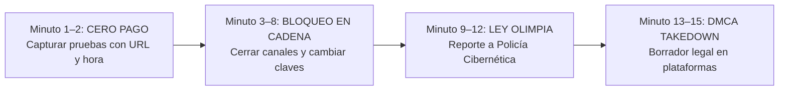

# 05 · Ciberseguridad, Antifraude y Blindaje Financiero
> Protocolo de Prevención de Contracargos, Detección de Estafas y Protección de Cuentas para Creadoras Digitales Independientes  
> Versión 1.0 · Noviembre 2026 · Generado con Claude Sonnet 4.6

> ⚠️ **Aviso informativo:** Este documento proporciona lineamientos técnicos y preventivos de seguridad digital. Para situaciones legales activas, acudir siempre ante las autoridades competentes o un abogado especializado en delitos informáticos.

---

## BLOQUE 1 — PREVENCIÓN Y DEFENSA CONTRA CONTRACARGOS (CHARGEBACKS)

### ¿Qué es un contracargo bancario?
Un contracargo (*chargeback*) ocurre cuando un comprador deshonesto consume tu contenido digital y posteriormente llama a su banco afirmando *"no reconozco esta compra"*. El banco retira el dinero de forma preventiva y, en procesadores tradicionales no especializados, el vendedor pierde tanto el importe de la venta como una multa de disputa ($15 a $25 USD).

### Nivel de Protección contra Contracargos por Plataforma:

| Plataforma / Pasarela | Riesgo de Contracargo | Nivel de Protección para la Creadora |
|---|:---:|---|
| **PayPal** | 🔴 **MUY ALTO** | Pésima protección para bienes digitales; congela fondos al detectar actividad +18. **Prohibido usarlo.** |
| **Tarjeta directa (Stripe propio)** | 🟡 **MEDIO** | Requiere aportar pruebas manuales de descarga e IP ante el banco emisor. |
| **Fansly** | 🟢 **BAJO** | **Blindaje total:** La plataforma absorbe el riesgo de fraude con tarjeta y protege tu saldo. |
| **ManyVids / LoyalFans** | 🟢 **BAJO** | **Blindaje total:** Cuentan con registros automáticos de IP y descarga que defienden a la modelo. |
| **Throne (Wishlist / Cash)** | 🟢 **MUY BAJO** | Los regalos y financiamientos pasan por filtros antifraude estrictos antes de acreditarse. |
| **Criptomonedas (USDT)** | 🟢 **CERO (0%)** | Las transacciones en blockchain son **100% irreversibles** por diseño matemático. |

---

### Evidencia Digital que Debes Conservar (Carpeta de Respaldo por 180 Días)
Para ventas de alto valor por mensaje directo, conserva siempre en una carpeta organizada por fecha:
1. **Captura del pedido entregado o descargado** con fecha y hora visible.
2. **Captura de la conversación** donde el cliente agradece o comenta sobre el video recibido.
3. **Recibo de confirmación** de la plataforma (Throne o Fansly).

---

## BLOQUE 2 — DETECCIÓN DE LAS 3 ESTAFAS MÁS COMUNES

### Estafa #1 · El "Sugar Daddy" del Comprobante Falso
- **Cómo operan:** Un supuesto millonario te escribe ofreciendo $300 USD, te manda una captura de pantalla editada diciendo *"Ya te transferí, mándame el video en lo que se refleja"* o te pide pagar una "comisión de liberación".
- **Señales de alerta:** Capturas con tipografía borrosa, correos falsos de confirmación (`@paypal-security-pay.com`) o excusas de que *"mi banco internacional tarda 24 horas"*.

> **🔑 Regla de Oro Inquebrantable:**  
> **El dinero solo existe cuando aparece reflejado dentro del balance oficial de tu aplicación (Throne, Fansly o DolarApp). Jamás entregues una sola foto basándote en una captura de pantalla enviada por el cliente.**

---

### Estafa #2 · El Archivo Adjunto Malicioso (Robo de Sesión / Session Hijacking)
- **Cómo operan:** Un usuario te dice *"Quiero un video personalizado con esta pose, te mando el ejemplo en este archivo"* y te envía un archivo `.zip`, `.rar`, `.exe`, `.scr` o un enlace extraño.
- **El Peligro:** Ese archivo contiene un troyano que roba las *cookies* activas de tu navegador, dándole acceso a tu cuenta de X, Gmail y Fansly sin necesidad de saber tu contraseña.
- **Regla Absoluta:** **Jamás descargues ni abras archivos `.zip`, `.exe` ni enlaces desconocidos.** Si un cliente quiere explicarte qué desea, que lo escriba con texto plano en el chat. Analiza cualquier enlace sospechoso en [virustotal.com](https://www.virustotal.com/).

---

### Estafa #3 · La Falsa "Colega Creadora" o Agencia Fantasma
- **Cómo operan:** Cuentas recién creadas que te ofrecen "intercambio de promoción" (*S4S*) pidiéndote videos sin marca de agua por adelantado, o falsas agencias que prometen "llevarte a ganar $10,000 USD" si les entregas la contraseña de tus redes. **Nadie legítimo te pedirá jamás tus accesos.**

---

## BLOQUE 3 — BLINDAJE DE CUENTAS: 2FA REAL Y PREVENCIÓN DE SIM SWAPPING

### Por Qué el Código por SMS es Peligroso en México
En México existe el fraude de **SIM Swapping**: un atacante engaña a un empleado de telefonía (Telcel, AT&T, Movistar) para reportar tu chip como extraviado y pasar tu número telefónico a un chip vacío en manos del delincuente. Si tus cuentas tienen la verificación de dos pasos (2FA) por **mensaje SMS**, el atacante recibirá los códigos para vaciar tus cuentas.

### La Solución Definitiva: App Autenticadora (Offline)

| Método de Verificación (2FA) | Nivel de Seguridad | ¿Vulnerable a Robo de Chip (SIM Swap)? |
|---|:---:|:---:|
| **Mensaje de texto SMS / Llamada** | 🔴 **BAJO** | **Sí — 100% vulnerable** |
| **Correo electrónico** | 🟡 **MEDIO** | Solo si usan la misma contraseña |
| **App Autenticadora (Ente Auth / Aegis / Google Auth)** | 🟢 **ALTO** | **NO — Funciona sin señal telefónica** |
| **Llave física USB/NFC (YubiKey)** | 🟢 **GRADO MILITAR** | **NO — Imposible de clonar a distancia** |

### Pasos de Blindaje en 5 Minutos:
1. Descarga en tu celular la aplicación gratuita **Ente Auth** (iOS/Android) o **Google Authenticator**.
2. Entra a la configuración de seguridad de tu **Gmail, X, Fansly, ManyVids y DolarApp**.
3. Activa la *"Verificación en dos pasos mediante App Autenticadora"* y desactiva la recuperación por SMS.
4. **Escribe en una libreta de papel física** los 10 códigos de respaldo de emergencia y guárdala en un cajón seguro de tu casa (jamás en las notas del celular ni en la galería de fotos).

---

## BLOQUE 4 — PROTOCOLO DE EMERGENCIA EN 15 MINUTOS (ANTI-EXTORSIÓN Y LEY OLIMPIA)

En el remoto caso de que algún individuo intente amenazarte o intimidarte en redes (*doxxing* o extorsión), ejecuta con frialdad quirúrgica este protocolo de 4 pasos en los primeros 15 minutos:

### Paso 1 · Cero Pago y Captura de Evidencia (Minutos 1 a 2)
- **Jamás entregues ni un solo peso ni contenido adicional.** Pagarle a un extorsionador confirma que tiene poder sobre ti y garantiza que volverá a pedir más dinero.
- Toma captura de pantalla completa del mensaje de amenaza donde se vea el nombre de usuario (`@handle`), la fecha, la hora y el enlace directo a su perfil.

### Paso 2 · Bloqueo Total y Aislamiento (Minutos 3 a 8)
- Bloquea inmediatamente al agresor en todas las plataformas.
- Cambia temporalmente el nombre de usuario (`@handle`) de tu cuenta de X o ponla con candado privado durante 48 horas: al cambiar el `@handle`, cualquier enlace previo que el agresor haya copiado quedará roto (error 404).

### Paso 3 · Respaldo Legal: La Ley Olimpia en México (Minutos 9 a 12)
En todo el territorio mexicano rige la **Ley Olimpia** (reformas al Código Penal Federal y códigos estatales), la cual castiga con **3 a 8 años de prisión** a quien amenace con difundir, publique o comparta contenido íntimo sin consentimiento explícito, **incluso si tú misma grabaste o vendiste originalmente ese material**.

### Directorio Oficial de Respuesta Inmediata en México:

| Institución Oficial | Función | Contacto Directo |
|---|---|---|
| **Policía Cibernética (SSC)** | Rastreo técnico, baja de perfiles de extorsión y asesoría 24/7 | Tel: **55 5242-5100 ext. 5086** |
| **Fiscalía General (FGR — UICOT)** | Denuncia penal federal por delitos cibernéticos | [gob.mx/fgr](https://www.gob.mx/fgr) |
| **CONDUSEF** | Defensa ante cargos bancarios o suplantación financiera | Tel: **55 5340-0999** |
| **Cyber Civil Rights Initiative** | Organización internacional para baja exprés de imágenes | [cybercivilrights.org](https://cybercivilrights.org/) |

### Paso 4 · Eliminación Inmediata por Derechos de Autor (DMCA Takedown)
Todo video o foto que tú tomas con tu celular te pertenece legalmente bajo las leyes internacionales de **Copyright (DMCA)**. Si alguien sube una foto tuya sin permiso, no reportes por "acoso" (que tarda días); reporta por **Infracción de Derechos de Autor (DMCA)** en estos enlaces oficiales y la plataforma borrará el archivo en cuestión de horas:
- **X (Twitter) DMCA:** `help.twitter.com/forms/dmca`
- **Instagram / Meta DMCA:** `help.instagram.com/copyright`
- **Google Search Removal:** `support.google.com/legal/troubleshooter/1114905`
- **Reddit Copyright:** `reddit.com/report`
