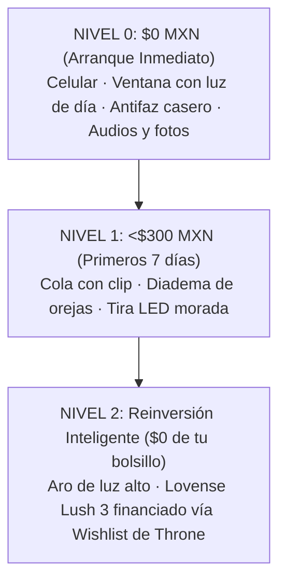
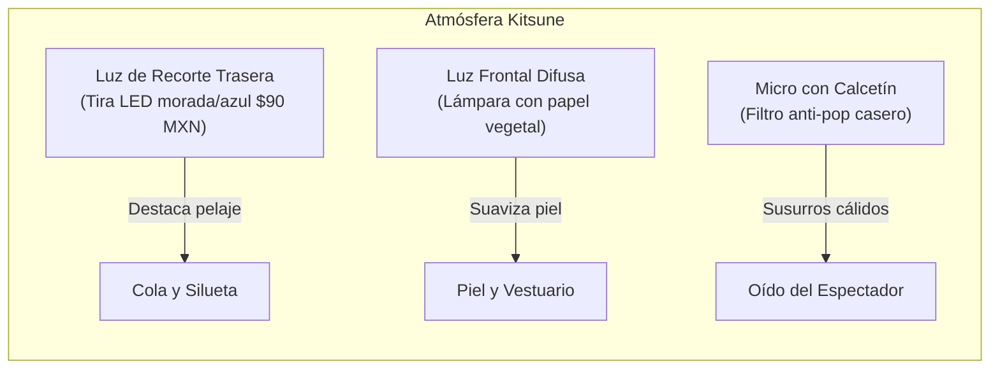

# BLOQUE 2 (PÁGS. 6 A 10): EL KIT DE ARRANQUE $0 Y LA TRANSFORMACIÓN KITSUNE

---

## PÁGINA 6 — LA ESCALERA DE INVERSIÓN: ARRANCA HOY CON LO QUE TIENES

Uno de los mayores mitos que paralizan a las mujeres que desean incursionar en la economía digital es la creencia de que necesitan gastar miles de pesos en equipo profesional, cámaras réflex y juguetes costosos antes de ganar su primer dólar.

La realidad operativa es exactamente la contraria: **las creadoras más rentables arrancan con un presupuesto de $0 a $300 MXN y dejan que sean sus propios compradores quienes financien el equipo profesional mediante donaciones y tributos.**



### La Escalera de 3 Niveles:

| Nivel de Presupuesto | Equipo Requerido | Costo Real | Fuentes de Ingreso Inmediatas | Meta Financiera |
|---|---|:---:|---|:---:|
| **Nivel 0** | Cámara de tu celular + luz de ventana + antifaz de encaje o técnica "Collarbone Down" + auriculares con cable. | **$0 MXN** | Venta de audios personalizados ASMR, packs de fotos en ManyVids y mensajes de pago en Telegram. | **$100 a $250 USD** en los primeros 15 días. |
| **Nivel 1** | Kit básico de cosplay: cola de zorro con clip para cinturón ($150 MXN) + diadema de orejas ($80 MXN) + tira LED ($90 MXN). | **<$320 MXN** | Activación del embudo de clips de 7 segundos en TikTok/Reels/X y apertura de transmisiones en vivo anónimas. | **$300 a $500 USD/mes**. |
| **Nivel 2** | Aro de luz con tripié de 1.80m ($350 MXN) + juguete interactivo con vibración por propinas (Lovense Lush 3: ~$129 USD). | **$0 MXN** *(Financiado 100% por fans en Throne)* | Shows en vivo gamificados por tokens (Stripchat/Fansly) y subasta de artículos físicos personalizados. | **$600 a $1,200+ USD/mes**. |

> **📌 Regla de Oro Financiera:**  
> Jamás saques dinero de tu cuenta bancaria personal para comprar juguetes caros o equipo sofisticado. El primer objetivo del personaje es conseguir su propio financiamiento: **el público que desea verte con mejor luz o juguetes interactivos es quien debe pagar por ellos.**

---

## PÁGINA 7 — EL OUTFIT KITSUNE: DE DÓNDE SACARLO Y CÓMO SUJETARLO

El arquetipo de la zorrita (*kitsune*) es visualmente poderoso porque combina elementos de fantasía, ternura y seducción implícita sin exigir ropa extravagante ni costosa. De hecho, el contraste entre prendas cotidianas que ya tienes en tu guardarropa y los accesorios de zorro es lo que dispara la fascinación del espectador.

```
       /\_/\      << Diadema de orejas afelpadas ($80 MXN)
      ( o.o )     << Mechones frontales cubriendo bordes del rostro
       > ^ <      << Antifaz de encaje o gargantilla choker
      /|   |\     << Sudadera oversize o camisa blanca suelta
     / |   | \    << Falda tableada o shorts deportivos cortos
       |===|      << Cinturón / pretina donde se engancha el clip
        \  \      << COLA DE ZORRO ESPONJOSA CON CLIP ($150 MXN)
         \__)
```

### 1. La Cola de Zorro: Comodidad y Sujeción Segura
- **El Modelo con Clip / Broche al Cinturón (Recomendado):**  
  A diferencia de los modelos con sujeción interna que pueden resultar invasivos o incómodos para principiantes, la cola con **clip metálico o mosquetón** se engancha directamente a la pretina de un short deportivo, una falda tableada o un cinturón delgado oculto bajo la ropa.
  - *Ventaja operativa:* Es 100% cómoda, te permite sentarte, arrodillarte o moverte libremente durante horas sin ninguna molestia.
  - *Dónde conseguirla:* En Mercado Libre, Amazon México o Shein buscando *"Cola de zorro cosplay peluche con broche"* por menos de **$150 a $180 MXN**.

### 2. Las Orejas y el Peinado Estratégico
- **Diadema de orejas afelpadas flexibles:** Busca orejas con alambre interno que permitan moldear la inclinación (hacia arriba para atención despierta, ligeramente caídas para sumisión o ternura).
- **El Peinado Antifugas:** Deja caer dos mechones largos de cabello natural hacia adelante sobre los pómulos. Este peinado enmarca la boca y la barbilla mientras oculta las orejas reales y la mandíbula lateral, blindando tu identidad sin necesidad de máscaras pesadas.

### 3. El Guardarropa que Ya Tienes en Casa
No necesitas lencería de diseñador. La audiencia internacional responde con mayor entusiasmo a combinaciones casuales con alta carga estética:
- **Look 1 ("La Gamer Relajada"):** Sudadera holgada *oversize* que cubra hasta los muslos, calcetas altas musleras (arriba de la rodilla) y la cola saliendo por debajo de la sudadera al caminar.
- **Look 2 ("El Estilo Anime"):** Falda escolar tableada corta, camisa blanca con cuello y gargantilla tipo *choker* de listón negro.
- **Look 3 ("Madriguera Nocturna"):** Bata corta de seda o satín con shorts deportivos diminutos.

---

## PÁGINA 8 — ENCUADRES CLAVÍCULA-ABAJO Y OCULTAMIENTO SIN FILTROS AR

El mayor error de las principiantes es confiar en filtros digitales de TikTok o Instagram para tapar su rostro. Si la aplicación sufre un microcorte de señal o un fallo en el procesador gráfico, tu rostro real queda expuesto en video grabado para siempre.

El ocultamiento profesional es **físico y cinemático**, no digital.

### 1. La Técnica "Collarbone Down" (Clavícula Hacia Abajo)

```
      [ ZONA FUERA DE CUADRO ]  ---> Ojos, nariz y frente nunca entran al lente
  ~~~~~~~~~~~~~~~~~~~~~~~~~~~~~~ 
     [ LÍNEA DE CORTE SUPERIOR ] ---> Labios inferiores (opcional al hablar) o cuello
            [ CHOKER ]           ---> Gargantilla que delimita visualmente el encuadre
         [ CLAVÍCULA ]           ---> Punto de anclaje estético superior
         [ TORSO / CINTURA ]     ---> Movimiento rítmico
         [ COLA DE ZORRO ]       ---> Elemento cinético principal en movimiento
  ~~~~~~~~~~~~~~~~~~~~~~~~~~~~~~
     [ LÍNEA DE CORTE INFERIOR ] ---> Mitad de muslos o rodillas
```

- **Configuración del Teléfono:**  
  Coloca el celular en un soporte o vaso sobre un mueble a la altura de tu ombligo, apuntando ligeramente en ángulo descendente (unos 15 grados hacia abajo).
- **El Resultado Visual:**  
  La toma captura desde la gargantilla y la clavícula hasta la cadera y los muslos. El espectador observa tu respiración, tus manos y el vaivén hipnótico de la cola, pero tu rostro completo queda físicamente fuera del sensor de la cámara. Cero margen de error.

### 2. La Técnica del "Espejo con Flash" (Cero Edición y Alto CTR)
Es el formato fotográfico más viral en X (Twitter) para creadoras anónimas:
1. Entra a tu habitación o baño con la luz del techo apagada. Enciende únicamente una luz tenue en el fondo (como la tira LED azul o roja de $80 MXN).
2. Párate frente al espejo a metro y medio de distancia de espaldas o medio perfil, mostrando la silueta de la cola y las orejas.
3. Abre la cámara trasera de tu celular y activa la **linterna/flash permanente**.
4. Coloca el teléfono **exactamente frente a tu cara** a la altura de los ojos para tomar la foto en el reflejo del espejo.
5. **El Efecto Óptico:** El destello del flash en el espejo genera una esfera de luz blanca brillante que ciega por completo el reflejo de tu rostro, mientras proyecta una luz perfecta sobre tus hombros, tu cintura y la silueta esponjosa de la cola. Obtienes una foto con estética analógica misteriosa sin editar una sola línea.

---

## PÁGINA 9 — ILUMINACIÓN CASERA Y AUDIO ÍNTIMO (EL EFECTO KITSUNE)

La atmósfera de tu habitación define si tu contenido se percibe como una grabación descuidada o como una producción estética de alta gama. Con dos ajustes lumínicos y una técnica de audio casera, el valor percibido de tus videos se multiplica por diez.



### 1. Iluminación de Recorte: El Secreto del Pelaje Esponjoso
El ojo humano detecta el volumen gracias al contraste en los bordes. Si grabas con un solo foco de techo, la cola de zorro se verá oscura y apelmazada.
- **La Solución:** Coloca una fuente de luz cálida o de color (la tira LED o una lámpara pequeña) **detrás de ti en el suelo o sobre un mueble bajo**, apuntando hacia tu espalda.
- **El Efecto:** La luz trasera atraviesa las fibras del pelaje sintético de la cola y las orejas, creando un borde luminoso brillante (*rim light*) que hace que el accesorio se vea costoso, mullido y sumamente llamativo en pantalla.

### 2. Audio Íntimo: El Filtro Anti-Pop Casero y el Roce ASMR
En el nicho kemonomimi, el 60% de la seducción entra por los oídos. La voz suave, la respiración pausada y los susurros (*ASMR kitsune*) convierten a mirones casuales en clientes fieles de audios personalizados.
- **El Filtro de Calcetín:**  
  Toma un calcetín delgado de algodón limpio y cubre el micrófono de tus auriculares con cable fijándolo con una liga. Esto elimina las ráfagas de aire al pronunciar palabras con "p" y "b", logrando un tono de voz aterciopelado idéntico al de un micrófono de condensador de $3,000 MXN.
- **El Roce Táctil (Gatillo Sensorial):**  
  Frotar suavemente las puntas del pelaje de la cola contra la cápsula protegida del micrófono mientras susurras genera un sonido de caricia auditiva que vuelve locos a los oyentes con audífonos.

---

## PÁGINA 10 — CHECKLIST DE DESPEGUE EN 48 HORAS (LISTO PARA PUBLICAR)

No postergues el inicio esperando un momento "perfecto". Si completas esta lista de verificación de 10 puntos en las próximas 48 horas, tu negocio digital estará operativo y generando tráfico:

### Lista de Verificación Previa al Lanzamiento:

| # | Punto de Control Táctico | Estado |
|:---:|---|:---:|
| **1** | **Identidad Separada:** Correo Gmail exclusivo creado sin nombres ni datos personales reales. | `[ ]` |
| **2** | **Alias Comercial Definido:** Nombre artístico elegido (ej. *KitsuneVal, FoxNyx, VelvetTail*). | `[ ]` |
| **3** | **Geobloqueo Configurado:** Restricción de México y tu estado natal activa en tus plataformas receptoras. | `[ ]` |
| **4** | **Limpieza de Metadatos:** App **Metapho** o **Photo Exif Editor** instalada en el celular para borrar datos GPS. | `[ ]` |
| **5** | **VPN con Kill Switch:** **Mullvad** o **ProtonVPN** instalada y probada antes de abrir cualquier red social. | `[ ]` |
| **6** | **Outfit Básico Armado:** Cola de zorro sujeta al cinturón/short, orejas listas y peinado con mechones frontales. | `[ ]` |
| **7** | **Iluminación Probada:** Luz principal difusa de frente y luz de recorte trasera encendida iluminando la cola. | `[ ]` |
| **8** | **Audio con Filtro Anti-pop:** Auriculares de cable con calcetín protector listos para notas de voz íntimas. | `[ ]` |
| **9** | **Carpeta de Producción Lunes:** Al menos 6 clips de 7 segundos grabados con la técnica de clavícula abajo. | `[ ]` |
| **10** | **Enlace de Biografía Central:** Cuenta gratuita en Linktree o AllMyLinks enlazando tu Wishlist y canal de contacto. | `[ ]` |

> **🚀 Declaración de Acción:**  
> Una vez marcadas estas 10 casillas, tu espacio es oficialmente un canal de negocios en dólares. En el siguiente bloque aprenderás la ingeniería exacta para que los algoritmos de TikTok, Reels y X comiencen a enviarte miles de visitantes desde hoy mismo.
