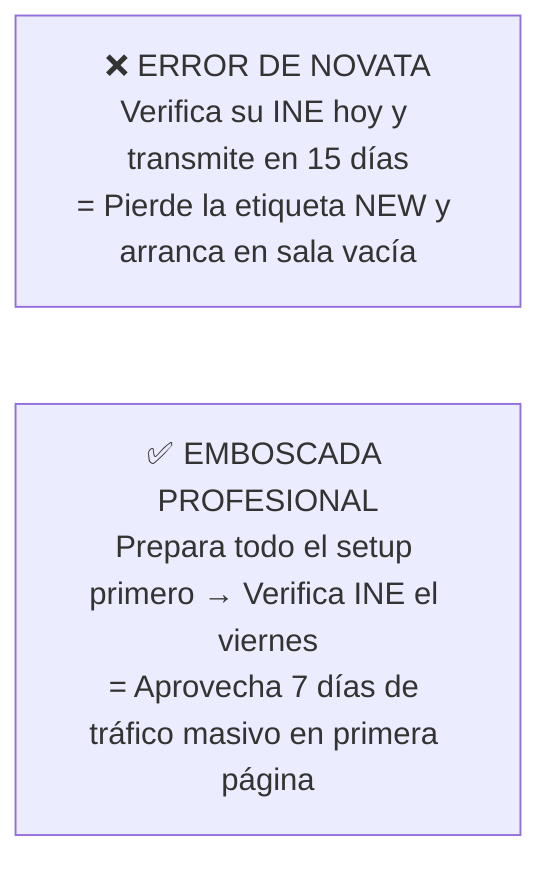
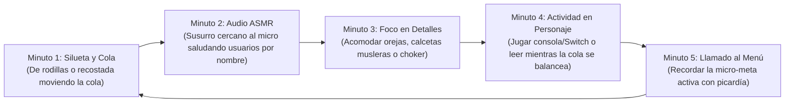

# BLOQUE 4 (PÁGS. 16 A 20): LA CÁMARA EN VIVO, LA ESCALERA DE TOKENS Y EL MANEJO DE SALAS

---

## PÁGINA 16 — DÓNDE TRANSMITIR: STRIPCHAT VS. CHATURBATE VS. FANSLY LIVE

Si decides sumar transmisiones en vivo (*live camming*) a tu ecosistema de ingresos, debes elegir tu trinchera basándote en **datos duros de flujo de dinero**, no en rumores de foros antiguos.

De acuerdo con el rastreo público de propinas de la industria (**Statbate / BaileyBae 2026**, sobre un volumen auditado de más de $96 millones de dólares en 4 semanas):

| Plataforma | Cuota del Pastel de Propinas (2026) | Valor de cada Token para la Creadora | Perfil del Tráfico | Veredicto para Zorra Faceless |
|---|:---:|:---:|---|---|
| **Stripchat** | **53.3%** *(Líder absoluto)* | **$0.05 USD** (1,000 tk = $50 USD) | Masivo desde celular, interfaz gamificada y excelente algoritmo para máscaras/cosplay. | ⭐ **#1 Recomendada para Live.** |
| **Chaturbate** | **35.0%** | **$0.05 USD** (1,000 tk = $50 USD) | Tráfico de escritorio tradicional de EE.UU.; requiere mayor uso de apps/bots de sala. | ⭐ **#2 Ideal para Multistreaming.** |
| **Fansly Live** | Crecimiento acelerado | **80% del valor del tip** | Tus propios seguidores de redes y tráfico interno de fetiches/cosplay. | ⭐ **Mayor margen neto (80%).** |

> **📌 La Regla de la Paridad de Tokens:**  
> En Stripchat y Chaturbate, cada token que ves en pantalla equivale exactamente a **$0.05 USD (5 centavos de dólar)** para ti.  
> - **100 tokens** = $5.00 USD (~$98 MXN).  
> - **500 tokens** = $25.00 USD (~$488 MXN).  
> - **1,000 tokens** = $50.00 USD (~$975 MXN).

---

## PÁGINA 17 — LA EMBOSCADA DE LA "NEW TAG" (TUS PRIMEROS 7 DÍAS DE ORO)

El error #1 que comete el 90% de las principiantes (documentado en miles de testimonios en *r/CamGirlProblems*) es crear su cuenta, verificar su documento de identidad "para ver cómo es la página" y no transmitir sino hasta dos semanas después.

### ¿Por Qué Ese Error Cuesta Miles de Dólares?
Tanto Stripchat como Chaturbate otorgan a cada cuenta recién aprobada una insignia especial llamada **"New" (Nueva Modelo)** durante sus **primeros 7 a 14 días exactos desde el minuto en que se aprueba el documento de identidad**.
- Mientras tienes la etiqueta *New*, el algoritmo coloca tu transmisión en la primera página frente a miles de grandes gastadores (*Whales*) que buscan exclusivamente caras (o máscaras) nuevas.
- Si verificas tu cuenta hoy y no enciendes la cámara durante esa semana, **desperdicias tu impulso algorítmico gratuito para siempre**.

### Protocolo para Aprovechar tu Etiqueta "New":
1. **No subas tu INE todavía:** Primero ten lista tu cola de zorro, tus orejas, tu iluminación trasera y tu cuenta de Throne.
2. **Verifica en miércoles o jueves:** Para que tu cuenta sea aprobada justo antes del viernes de quincena gringa (*Payday*).
3. **Transmite al menos 4 noches durante esa primera semana** en el horario pico (20:00 a 23:30 hrs CDMX). En esos primeros 7 días construirás la base de seguidores y favoritos que te dará de comer los meses siguientes.

---

## PÁGINA 18 — LA ESCALERA DE TOKENS (ARQUITECTURA PSICOLÓGICA DEL TIP MENU)

Una sala sin menú de propinas (*Tip Menu*) o con precios puestos al azar no convierte. Los hombres en las salas de cámara necesitan **micro-metas claras e inmediatas** que disparen dopamina y competencia social en el chat.

Configura exactamente esta **Escalera de Conversión en 4 Peldaños** para el personaje Kitsune:

| Peldaño | Acción en el Tip Menu | Precio en Tokens | Valor en USD | Función Psicológica en la Sala |
|---|---|:---:|:---:|---|
| **1. Rompehielos (Micro-compromiso)** | • *Ear Twitch (Mover orejitas)* • *Fox Purr (Ronroneo en el micro)* • *Say your name softly* | **15 tk** **25 tk** **35 tk** | $0.75 $1.25 $1.75 | Rompe la inercia del espectador callado. Una vez que un usuario gasta sus primeros 15 tokens, su cerebro entra en modo comprador. |
| **2. Cinética Visual (Impulso Medio)** | • *Stand up & Shake Tail (30s)* • *Show Paws / Calcetas de cerca* • *Spank the Fox (1 palmada)* | **75 tk** **90 tk** **111 tk** | $3.75 $4.50 $5.55 | Pone la cola en movimiento en primer plano, lo que atrae a decenas de usuarios nuevos desde las miniaturas de la página principal. |
| **3. Control y Estatus (Gasto Alto)** | • *Tease / Subir sudadera lento* • *Control my tail for 2 min* • *Write your name on my thigh* | **200 tk** **300 tk** **400 tk** | $10.00 $15.00 $20.00 | Apela al deseo de posesión territorial del donador frente a los demás hombres de la sala. |
| **4. Cierre Ballena (Whale Lock)** | • *Unlock Private / Exclusive Show* • *Secret Kitsune Show (Goal)* | **60 tokens/min** **1,000 tk (Meta)** | $3.00/min $50.00 | Saca al gran pagador de la sala pública hacia un show privado donde el margen por minuto se dispara. |

> **🔑 Secreto de Conversión:**  
> Nunca pongas una sola meta gigante de *"2,000 tokens para show completo"* desde el principio; una barra de progreso en 0% desanima a la sala. Divide la noche en **5 micro-metas consecutivas de 300 a 400 tokens** (*Meta 1: Quitarme las calcetas → Meta 2: Ponerse de rodillas → Meta 3: Baile de cola...*). Cada meta cumplida celebra y acelera la siguiente.

---

## PÁGINA 19 — EL MÉTODO "ZORRO-5" Y CÓMO DOMINAR LA SALA SIN DESNUDARTE GRATIS

La pregunta más común al transmitir es: *«¿Qué hago sentada frente a la cámara mientras entran usuarios y todavía nadie manda propinas?»*.

Si te quedas inmóvil mirando la pantalla con cara de aburrimiento o revisando tu WhatsApp, la sala morirá en 3 minutos. En cambio, aplicarás el **Ciclo "Zorro-5" (Rotación de 5 Minutos en Bucle)**:

### Cómo Neutralizar a los "Grises" (Mirones que Piden Cosas Gratis):
En las salas de webcams, los usuarios que no tienen tokens tienen el nombre en color **gris**. Muchos intentarán escribirte: *"Show boobs", "Take off the mask", "Stand up free"*.
1. **Regla #1:** En los ajustes de tu sala, **silencia el chat para usuarios sin tokens**. Quien quiera escribir en tu sala debe tener saldo cargado en su cuenta.
2. **Regla #2:** Si alguien pide algo sin pagar, jamás te enojes ni discutas. Señala tu menú con una sonrisa pícara bajo el antifaz y di: *"The fox only obeys tokens, baby. Check the menu"*.

---

## PÁGINA 20 — JUGUETES INTERACTIVOS (LOVENSE) Y CÓMO FINANCIARLOS CON TUS FANS

En la industria del streaming anónimo, existe un antes y un después de incorporar un juguete interactivo controlado por propinas (**Lovense Lush 3** o **Domi 2**).

### ¿Por Qué Duplica las Propinas Automáticamente?
Cuando conectas un juguete interactivo por Bluetooth a tu transmisión, cada vez que un usuario envía tokens, el dispositivo vibra automáticamente al ritmo de la propina.
- **El Gatillo Psicológico:** El hombre en Estados Unidos deja de ser un espectador pasivo y siente que **tiene un control físico directo sobre tu reacción en tiempo real** desde miles de kilómetros de distancia.
- Las salas que tienen el icono de *Interactive Toy* activo reciben un **filtro preferencial en la página de inicio de Stripchat y Chaturbate**, aumentando las propinas por hora entre un **60% y un 120%**.

### El Truco del "Juguete Fantasma" Mientras Reúnes el Dinero:
Un Lovense Lush 3 cuesta alrededor de **$119 a $129 USD**. Como vimos en el Bloque 2, **tú no lo vas a pagar de tu bolsillo**:
1. Sube el juguete a tu lista de deseos de **Throne** activando la opción de *Crowdfunding (Financiamiento colectivo)* o crea una meta en tu sala llamada: *"Help the fox get her first Lovense Lush ($0 / $120)"*.
2. **La promesa de recompensa:** Anuncia que los 3 principales donadores que ayuden a completar la meta recibirán un video privado exclusivo de 5 minutos el día que llegue la caja. En menos de dos semanas de transmisiones constantes, tus propios seguidores habrán pagado el 100% del dispositivo.
