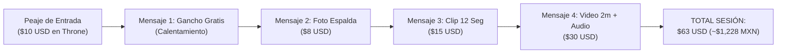

# BLOQUE 5 (PÁGS. 21 A 25): LAS 6 MICRO-MONETIZACIONES Y EL SWIPE FILE BILINGÜE

---

## PÁGINA 21 — EL ECOSISTEMA DE LAS 6 VÍAS Y LA REGLA DE LOS $8 USD/HORA

La diferencia entre una chica que gana $100 dólares esporádicos y una empresaria digital que factura **$600 a $1,000+ USD cada mes** radica en la **diversificación de micro-transacciones**. No necesitas encender la cámara en vivo todos los días si tienes 6 fuentes de ingreso operando simultáneamente desde tu teléfono.

### Matriz de Unit Economics: Rentabilidad por Hora

| Vía de Micro-Monetización | Costo de Insumo (MXN) | Tiempo Invertido | Precio de Venta (USD) | Margen Neto (%) | Ganancia por Hora (USD/hr) |
|---|---|:---:|:---:|:---:|:---:|
| **1. Wishlist / Throne Cash** | $0 MXN | 5 min (configuración) | $10 a $150+ USD | **95%–100%** | **Variable / Infinito** |
| **2. Artículos Físicos con Aroma** | $45 a $80 MXN | 30 min (empaque) | $45 a $70 USD | **88%+** | **$70+ USD/hr** |
| **3. Drip Sexting (Chat Guiado)** | $0 MXN | 15 a 20 min | $41 a $53 USD | **90%+** | **$120+ USD/hr** |
| **4. Packs "Paws & Tails" (ManyVids)**| $0–$60 MXN | 25 min (una sola vez) | $14.99 USD (pasivo) | **60%–80%** | **Ingreso Pasivo Recurrente** |
| **5. Soft Findom & Tributos** | $0 MXN | 10 min | $10 a $20 USD | **90%+** | **$60+ USD/hr** |
| **6. Audio ASMR Personalizado** | $0 MXN | 15 min | $15 a $25 USD | **95%** | **$60+ USD/hr** |

> **📌 La Regla de Corte de los $8 USD/Hora:**  
> Tu tiempo es el único activo no renovable. Cualquier actividad o cliente que te genere menos de **$8.00 USD por hora (~$156 MXN/hr)** durante dos semanas seguidas se elimina o se sube de precio sin nostalgia.

---

## PÁGINA 22 — VÍAS 1 Y 2: WISHLISTS ANÓNIMAS (THRONE) Y MERCH FÍSICO PERFUMADO

### Vía 1 · Throne.com: Cómo Recibir Regalos y Dólares en Efectivo Sin Dar tu Dirección
**Jamás uses la lista de deseos de Amazon**, ya que revela tu nombre real y tu ciudad al comprador. El estándar mundial para creadoras anónimas en México es **Throne**:
- **Mecanismo "Throne Cash":** En lugar de esperar paquetes físicos de EE.UU. que se detienen en la aduana mexicana, activas la función de recibir el regalo en **saldo en efectivo (USD)**. El fan paga con Apple Pay creyendo que te compró unas orejas o tu despensa, y tú retiras los dólares directo a tu cuenta para comprar en Mercado Libre.
- **Las 3 Listas que Más Convierten:**
  1. *«Para mejorar los videos»* → Aro de luz ($25 USD), tripié ($15 USD).
  2. *«Para la zorrita»* → Cola nueva ($35 USD), calcetas musleras ($12 USD), Lovense Lush ($129 USD en crowdfunding).
  3. *«Para la madriguera»* → Café, snacks, cena del viernes ($15–$40 USD). *(Es la que más rápido pagan: al comprador le fascina sentir que consiente y alimenta a su personaje favorito).*

---

### Vía 2 · Artículos Físicos Personalizados (Margen del 90% Sin Inventario)
Los coleccionistas del nicho *kemonomimi* tienen una fijación sensorial altísima con el sentido del olfato y la posesión de un objeto tangible usado por ti:
1. **Calcetas altas musleras usadas + foto comprobante:** Las compras en Shein o tiendas locales por $45 MXN. Las usas en un video corto y las vendes en **$50 a $70 USD + envío**.
2. **Diadema de orejas de zorro con tu perfume:** Diadema de $80 MXN rociada generosamente con un *body mist* dulce de vainilla o coco. Precio de venta: **$60 USD**.
3. **Foto tipo Polaroid impresa y firmada con beso:** Imprimes una foto tuya en cosplay (sin rostro) en cualquier kiosco fotográfico por $8 MXN, la firmas con plumón plateado y marcas un beso con labial rojo en el reverso. Venta: **$20 USD**.

- **Protocolo de Envío 100% Anónimo desde México:**  
  Guarda la prenda en una bolsa *Ziploc* cerrada al vacío (para conservar el aroma) dentro de un sobre burbuja discreto. En el remitente pon un nombre comercial genérico (*«Estudio K Design»*) y la dirección de una sucursal de **Correos de México (Mexpost) o DHL lejana a tu domicilio**. Cobra siempre el producto y el envío por adelantado en Throne.

---

## PÁGINA 23 — VÍA 3: EL SISTEMA "DRIP SEXTING" EN INGLÉS ($53 USD EN 15 MINUTOS)

No necesitas hablar inglés para facturar en dólares por mensaje privado. Cuando un usuario de Estados Unidos paga los **$10 USD** de tu peaje de entrada en X y te escribe por Telegram o Fansly, solo tienes que **copiar y pegar esta secuencia exacta de 4 pasos (Venta por Goteo)**:

### Plantilla Copy-Paste Paso a Paso:

| Orden | Mensaje Exacto en Inglés (Cópialo y Pégalo) | Qué Significa en Español |
|:---:|---|---|
| **1. Apertura Gratis** | `Hey… the $10 cleared. I’m still wearing the ears. The tail is on the bed next to me. Want to see how it looks from behind?` | *Hola... ya pasaron los $10. Sigo con las orejas puestas. La cola está en la cama junto a mí. ¿Quieres ver cómo se ve de espaldas?* |
| **2. Foto 1 ($8 USD)** | `I took this right after you paid. Back view, tail up, mask still on. Just the photo is $8. Want it?` | *Me tomé esta justo después de que pagaste. De espaldas, cola arriba, antifaz puesto. Solo la foto cuesta $8. ¿La quieres?* |
| **3. Video 12s ($15 USD)** | `The photo wasn’t enough, was it? I recorded 12 seconds of me moving the tail on purpose. Slow, on my bed. $15 for the clip. Say yes and I’ll send it.` | *La foto no fue suficiente, ¿verdad? Grabé 12 segundos moviendo la cola a propósito. Lento, en mi cama. $15 por el clip. Di que sí y te lo mando.* |
| **4. Cierre ($30 USD)** | `Last one. 2 minutes. I say your name while I move the tail and the ears stay on. Voice note included. $30. Once you pay I record it right now.` | *El último. 2 minutos. Digo tu nombre mientras muevo la cola con las orejas puestas. Incluye nota de voz. $30. En cuanto pagues lo grabo.* |

### Escudo Antifugas: Qué Responder si Pregunta *"Can I see your face?"*
- **Opción Traviesa:** `No. The mask stays on. You paid for the fox, not my face. Keep asking and the price goes up.` *(No. El antifaz se queda. Pagaste por la zorra, no por mi cara. Sigue preguntando y el precio sube).*
- **Opción Tímida:** `I… I can’t. The mask has to stay. I get too shy if you see my face. The ears and the tail are what you get.` *(No puedo. Me da demasiada pena si ves mi cara. Las orejas y la cola son lo que tienes).*

---

## PÁGINA 24 — VÍAS 4 Y 5: PACKS "PAWS & TAILS" EN MANYVIDS Y SOFT FINDOM

### Vía 4 · La Combinación Millonaria en ManyVids (Pies + Cola de Zorro)
Plataformas generales como Gumroad o PayPal congelan cuentas con contenido adulto. Tu tienda pasiva blindada es **ManyVids**, porque cuenta con un motor de búsqueda interno donde miles de hombres estadounidenses con tarjeta guardada buscan fetiches específicos a las 3:00 AM.

- **El Nicho "Paws & Tails" (Cero Competencia):**  
  Cruzar el fetiche de pies (*foot fetish*) con cosplay de zorrita es una mina de oro.
- **Cómo grabarlo en 15 minutos:** Ponte la cola de zorro y unas calcetas largas con diseño de huellitas en la planta (*cat/fox paws*, cuestan $60 MXN). Siéntate en la cama enfocando las plantas de tus pies en primer plano mientras tu silueta y la cola se mueven desenfocadas al fondo. Quítate las calcetas lentamente frente a la cámara durante 4 minutos.
- **Precio y Etiquetas SEO:** Sube el video a **$14.99 USD** con estas etiquetas exactas en inglés:  
  `#FoxGirl #Kemonomimi #CosplayFeet #Soles #SockPeel #AnonGirl`. Cada descarga mientras duermes es dinero pasivo.

---

### Vía 5 · Soft Findom y el Show de "Ignorar" ($20 USD)
El espíritu del zorro es caprichoso y superior. A un sector enorme de compradores le excita psicológicamente **pagar por ser ignorado con ternura y desdén**:
- **Cómo grabar una "Ignore Session":** Graba un video de 3 minutos acostada boca abajo en tu cama jugando en tu celular o Nintendo Switch, balanceando las pantorrillas y moviendo la cola de zorro en el aire. Al minuto y medio, voltea levemente sobre tu hombro (con antifaz) y ríete burlonamente. Se vende como pan caliente por **$19.99 USD** en ManyVids y Fansly bajo el título: *"Spoiled Kitsune Ignores You While Gaming"*.

---

## PÁGINA 25 — VÍA 6: NOTAS DE VOZ ASMR EN INGLÉS CON FONÉTICA

Los hombres en Estados Unidos enloquecen con el acento latino dulce hablando inglés lento y susurrado. Con estas tres plantillas fonéticas podrás grabar y vender notas de voz personalizadas de 30 segundos por **$15 a $25 USD** hoy mismo sin saber inglés:

### Instrucciones de Grabación en Cama:
1. Envuelve el micrófono de tus audífonos con un calcetín limpio (filtro anti-pop).
2. Durante los primeros 5 segundos, frota suavemente el pelaje de la cola contra el micrófono.
3. Lee en voz muy bajita y pausada el texto en **Negritas (Fonética)**:

#### Guión Audio 1 · Sensación de Pelaje ($15 USD)
- **Texto original:** *"Do you like how my tail feels…? It’s so fluffy… and heavy. I’m moving it slow for you… Can you hear it?"*
- **Léelo así al micrófono:**  
  🎙️ **`"Du yu laik jau mai teil fils…? (suspiro suave) Its sou flafi… and jevi. Aim muving it slou for yu… Can yu jir it?"`**

#### Guión Audio 2 · Respiración y Orejas ($15 USD)
- **Texto original:** *"The ears are still on… I’m whispering close to the mic. Can you hear me breathing…? Be good and listen."*
- **Léelo así al micrófono:**  
  🎙️ **`"De irs ar stil on… Aim güispering clous tu de maic… (respiración lenta) Can yu jir mi briding…? Bi gud and lisen."`**

#### Guión Audio 3 · Audio Personalizado con Nombre del Cliente ($25 USD)
- **Texto original:** *"Say my name… no. I’m saying yours. [Nombre del cliente]… you paid for this. The tail is moving just for you."*
- **Léelo así al micrófono:**  
  🎙️ **`"Sei mai neim… nou. Aim seying yors… [Pronuncia su nombre en susurro]… yu peid for dis. De teil is muving yost for yu."`**
